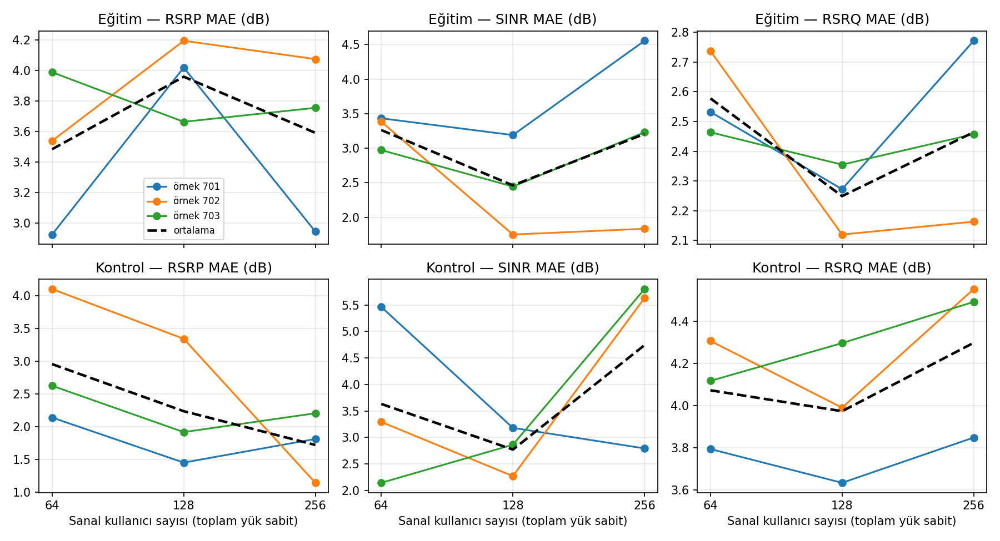

# Kullanıcı örneklemi duyarlılığı: 64 → 128 → 256 — 12 Kasım 2026

Soru: Seçilen radyo ayarının Experia ile karşılaştırması, saha başına az sayıda sanal kullanıcıya mı bağlı?

**Sabit tutulanlar:** seçilen ayar (2–6 km kümeler, 120°, n=3, 49 dBm, NF 9 dB, gölgeleme yok, Band 3 / 20 MHz, mixed CQI, 3 sektör), güncel envanterden 24 saha (hocanın 8+8 sahası dahil), üç anten-yönü/kullanıcı örneği (42/701, 7/702, 99/703), 4 s koşu, 1 s ısınma. **Değişen:** yalnız kullanıcı sayısı. Örnekler iç içe: 128 kullanıcının ilk 64'ü önceki 64 kullanıcıdır, 256'nın ilk 128'i de 128'liktir. **Toplam sunulan yük sabit:** kullanıcı başına UDP aralığı 50 / 100 / 200 ms (toplam ≈ 5,24 Mbit/s). Ayar yeniden seçilmedi. Kural koşulardan önce [plan.json](plan.json) içine yazıldı.

## 1. Bu PC'de yeniden üretim

64 kullanıcılık üç koşu, 12 Kasım koşularıyla (deney 07) aynı kullanıcılarda karşılaştırıldı:

| Örnek | Eşli UE | Aynı sektör | RSRP / SINR / RSRQ q95 fark (dB) |
|---|---:|---:|---|
| 701 | 64 | %100 | 0,000 / 0,000 / 0,000 |
| 702 | 64 | %100 | 0,000 / 0,000 / 0,000 |
| 703 | 64 | %100 | 0,000 / 0,000 / 0,000 |

## 2. Experia'ya göre hata — kullanıcı sayısına göre

Üç örneğin ortalaması ± standart sapması (dB; düşük daha yakın). ± üç örnek arası yayılımdır, güven aralığı değildir.

| Kullanıcı | Eğitim RSRP | Eğitim SINR | Eğitim RSRQ | Kontrol RSRP | Kontrol SINR | Kontrol RSRQ |
|---:|---:|---:|---:|---:|---:|---:|
| 64 | 3,49 ± 0,53 | 3,26 ± 0,25 | 2,58 ± 0,14 | 2,96 ± 1,02 | 3,63 ± 1,68 | 4,07 ± 0,26 |
| 128 | 3,96 ± 0,27 | 2,46 ± 0,72 | 2,25 ± 0,12 | 2,24 ± 0,98 | 2,77 ± 0,46 | 3,97 ± 0,33 |
| 256 | 3,59 ± 0,58 | 3,21 ± 1,36 | 2,46 ± 0,30 | 1,72 ± 0,54 | 4,74 ± 1,69 | 4,30 ± 0,39 |

Örnek bazında (eğitim / kontrol MAE, RSRP · SINR · RSRQ):

| Örnek | Kullanıcı | Eğitim | Kontrol | Bağlı / veri alan | Süre (s) |
|---|---:|---|---|---:|---:|
| 701 | 64 | 2,93 · 3,43 · 2,53 | 2,14 · 5,46 · 3,79 | 64/64 · 64/64 | 93 |
| 701 | 128 | 4,02 · 3,19 · 2,27 | 1,46 · 3,18 · 3,63 | 128/128 · 128/128 | 216 |
| 701 | 256 | 2,95 · 4,55 · 2,77 | 1,82 · 2,79 · 3,85 | 256/256 · 255/256 | 476 |
| 702 | 64 | 3,54 · 3,38 · 2,74 | 4,11 · 3,29 · 4,31 | 64/64 · 64/64 | 94 |
| 702 | 128 | 4,20 · 1,75 · 2,12 | 3,34 · 2,27 · 3,99 | 128/128 · 128/128 | 211 |
| 702 | 256 | 4,08 · 1,83 · 2,16 | 1,15 · 5,63 · 4,55 | 256/256 · 253/256 | 469 |
| 703 | 64 | 3,99 · 2,97 · 2,46 | 2,63 · 2,15 · 4,12 | 64/64 · 64/64 | 94 |
| 703 | 128 | 3,66 · 2,45 · 2,35 | 1,92 · 2,86 · 4,30 | 128/128 · 128/128 | 205 |
| 703 | 256 | 3,76 · 3,23 · 2,46 | 2,21 · 5,80 · 4,49 | 256/256 · 255/256 | 444 |

## 3. Değerlendirme sahası başına kullanıcı

Sahaya hizmet sektörü üzerinden bağlanan ve ölçüm üreten kullanıcı sayısı; üç örnekteki en küçük değer.

| Saha | n=64 | n=128 | n=256 |
|---|---:|---:|---:|
| SITE_000130 | 7 | 14 | 28 |
| SITE_000296 | 1 | 6 | 17 |
| SITE_000440 | 8 | 16 | 29 |
| SITE_000441 | 8 | 19 | 38 |
| SITE_000443 | 2 | 3 | 8 |
| SITE_000444 | 3 | 6 | 20 |
| SITE_000482 | 5 | 10 | 19 |
| SITE_000554 | 6 | 12 | 24 |

## 4. İlk 64 kullanıcının kendisi değişti mi?

Aynı konumdaki kullanıcılar küçük ve büyük koşuda eşleştirildi. Fark, yalnız kullanıcı başına yük ve zamanlama değişiminden gelir; konum ve ayar aynıdır.

| Örnek | Geçiş | Eşli UE | Aynı sektör | RSRP q95 | SINR q95 | RSRQ q95 | SINR ort. değişim |
|---|---|---:|---:|---:|---:|---:|---:|
| 701 | 64→128 | 64 | %100 | 0,00 | 1,07 | 0,00 | -0,30 |
| 701 | 128→256 | 128 | %100 | 0,00 | 0,59 | 0,00 | 0,04 |
| 702 | 64→128 | 64 | %100 | 0,00 | 1,04 | 0,00 | -0,26 |
| 702 | 128→256 | 128 | %100 | 0,00 | 0,55 | 0,00 | 0,05 |
| 703 | 64→128 | 64 | %100 | 0,00 | 0,78 | 0,00 | -0,14 |
| 703 | 128→256 | 128 | %100 | 0,00 | 0,63 | 0,00 | 0,05 |

## 5. Önceden yazılan yeterlilik ölçütü

- **128→256 geçişinde her örnek, her bölüm ve her metrikte MAE değişimi ≤ 0,5 dB:** geçmedi. En büyük değişim 3,36 dB (örnek 702, kontrol SINR). Eşiği aşan 7/18 durum.
- **Örnekler arası yayılım 256 kullanıcıda 64'e göre büyümüyor:** geçmedi.

  - Eğitim std (dB), RSRP 0,53 → 0,27 → 0,58; SINR 0,25 → 0,72 → 1,36; RSRQ 0,14 → 0,12 → 0,30
  - Kontrol std (dB), RSRP 1,02 → 0,98 → 0,54; SINR 1,68 → 0,46 → 1,69; RSRQ 0,26 → 0,33 → 0,39

## 6. Saha bazında işaretli hata (simülasyon − Experia)

Üç örneğin ortalaması (dB). Pozitif: simülasyon daha yüksek. Ortalama mutlak hata bu yönü gizler.

| Saha | Bölüm | SINR n=64 | SINR n=128 | SINR n=256 | RSRP n=64 | RSRP n=128 | RSRP n=256 |
|---|---|---:|---:|---:|---:|---:|---:|
| SITE_000130 | eğitim | +1,8 | +0,7 | +0,9 | -0,9 | -2,0 | -1,8 |
| SITE_000296 | eğitim | +3,2 | +1,6 | +5,7 | -2,8 | -4,1 | -0,0 |
| SITE_000440 | kontrol | +2,1 | +1,2 | +1,4 | +0,7 | +0,2 | +0,1 |
| SITE_000441 | kontrol | +2,8 | +2,2 | +5,5 | -4,4 | -4,7 | -1,5 |
| SITE_000443 | kontrol | +6,0 | +4,5 | +7,3 | +0,2 | -1,3 | +2,0 |
| SITE_000444 | eğitim | +3,9 | +3,8 | +4,5 | +1,8 | +1,9 | +2,7 |
| SITE_000482 | eğitim | +4,3 | +2,7 | +3,2 | -3,9 | -5,3 | -4,7 |
| SITE_000554 | eğitim | -2,0 | -2,5 | -1,6 | -6,2 | -6,4 | -5,5 |

## Yorum

- **İlk 64 kullanıcı değişmedi.** Aynı konumdaki kullanıcılarda RSRP/RSRQ farkı 0, hizmet sektörü %100 aynı, SINR q95 ≈ 1 dB ve altı. Yani hata değişimleri yük değişiminden değil, **yeni eklenen kullanıcı konumlarından** geliyor.
- **64 kullanıcılık sonuçlar örnekleme bağımlıymış.** Ölçüt geçmedi: 128→256 geçişinde bazı saha ortalamaları hâlâ birkaç dB oynuyor. Saha değeri, aktif sektörlerin eşit ağırlıklı ortalaması olduğundan yeni bir sektöre ilk kullanıcıların düşmesi saha ortalamasını sıçratabiliyor. SITE_000443 ve SITE_000296 256 kullanıcıda bile az örnekli.
- **RSRP kontrol hatası örneklem büyüdükçe azaldı** ve yayılımı daraldı; RSRQ yaklaşık sabit kaldı.
- **SINR için daha düşük 64-kullanıcı MAE kısmen şanstı.** Örnek büyüdükçe çoğu sahada simülasyon SINR'sinin Experia'dan **sistematik olarak yüksek** olduğu (SITE_000554 hariç) daha net görünüyor. Bu, ölçüm tanımı (mixed CQI, düşük yük) ve taşıyıcı/sektör varsayımları sorusunu güçlendiriyor.
- **Öneri:** Sonraki karşılaştırmalarda en az 256 kullanıcı ve saha başına en az ~15 örnek kullanılmalı; az örnekli sahalar ayrıca işaretlenmeli. İstenirse 512 kullanıcıyla bir yakınsama kontrolü (koşu başına ≈ 15–20 dk) yapılabilir. Seçilen radyo ayarı bu deneyde yeniden seçilmedi.

## Sınırlar

- Kullanıcı konumları varsayımsaldır (2–6 km kümeler); gerçek kullanıcı dağılımı bilinmiyor.
- Kontrol sahaları önceki çalışmalarda görüldü; kör doğrulama değildir.
- Kısa (4 s), düşük ve sabit toplam yükte radyo karşılaştırmasıdır; kapasite veya yük doğrulaması değildir.
- Kullanıcı sayısı arttıkça kullanıcı başına yük azaldı; mixed CQI SINR'si veri kanalı girişimine bağlı olduğundan bu, yük dağılımındaki değişimin etkisini de içerir.

[Tam sayısal sonuç](result.json) — [Önceden yazılan plan](plan.json) — [Hazırlık](prepare.py) — [Koşu](study.py)
