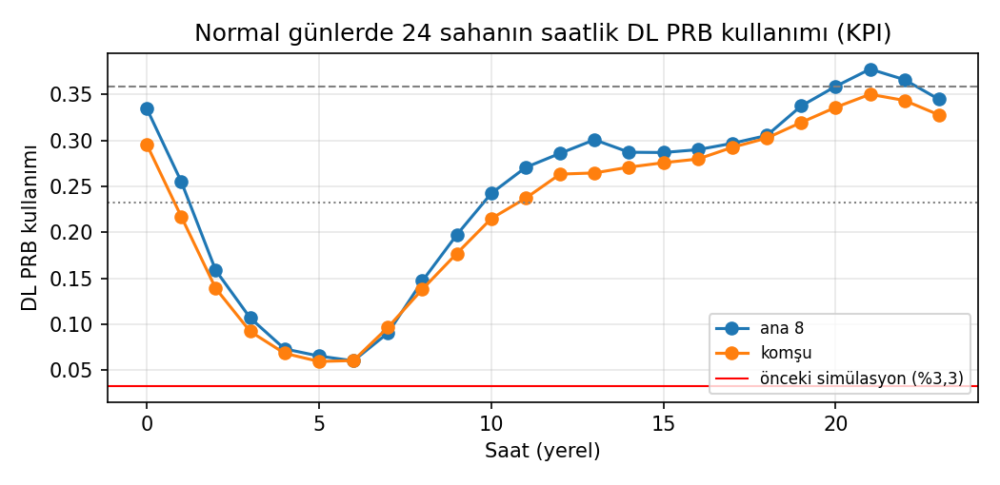
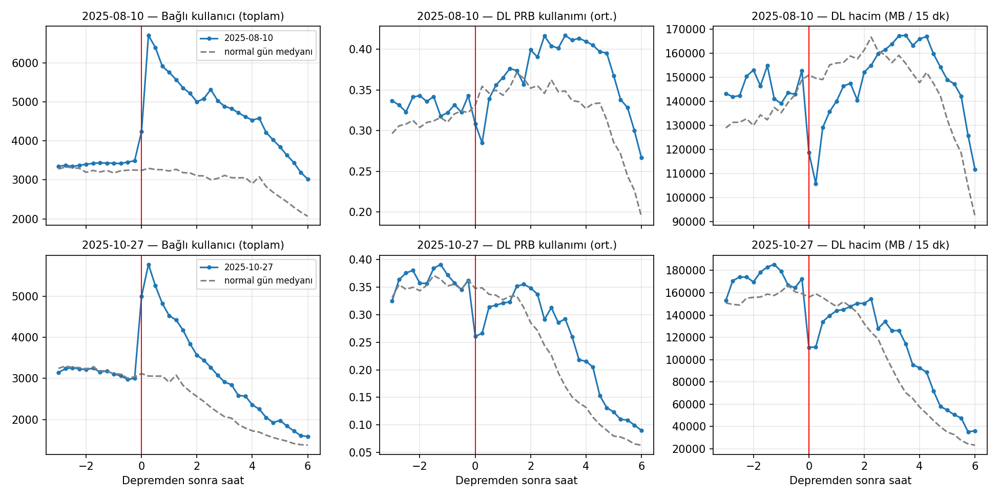
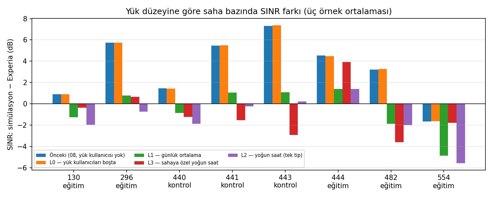

# KPI yük profili ve gerçekçi yükte radyo karşılaştırması — 12 Kasım 2026

> **15 Kasım ek uyarısı:** Raporlanan mixed SINR örneklerinin yalnız ≈%32–41'i veri kanalı girişimi içeriyor, kalanı birebir S/N. Bu çalışmadaki yük kullanıcılarının UDP trafiği eşzamanlı başladığından komşu sektörler aynı alt çerçevelerde yayın yapıyor. Düşük yükün SINR'yi iyimser gösterdiği sonucu geçerli; aşağıdaki sayısal yakınlık bu ortalama yöntemine bağlı. Ayrıntı: [Izgara kapsama haritaları](../10_kapsama_haritalari_2026-11-15/SONUCLAR.md).

İki soru: (1) KPI verisine göre bölgedeki ağ normal günde ve deprem anında ne kadar yüklü? (2) Simülasyona bu yükü verince Experia ile SINR farkı kapanıyor mu?

## 1. KPI'dan yük profili

Simülasyondaki 24 sahanın KPI'da bulunan 171 hücresi (ana 8 saha: 54, komşular: 117), 10 gün × 15 dakika. Hücre–saha bağlantısı güncel koordinat dosyasından hücre kimliğiyle kuruldu. Yük ölçüsü olarak birimsiz DL PRB kullanımı (0–1) seçildi; trafik hacmi/throughput birimleri henüz doğrulanmadı.

| Gösterge (normal günler) | Değer |
|---|---:|
| Günlük ortalama DL PRB | 0,233 |
| Yoğun saat (21:00) ortalaması | 0,359 |
| Gece en düşük saat | 0,061 |
| Yoğun saatte hücrelerin %90'lık dilimi | 0,793 |
| **Önceki simülasyon (08, 256 kullanıcı) sektör ortalaması** | **0,033** |

**Önceki simülasyon, ağı gerçeğe göre 7–10 kat daha boş çalıştırıyordu.**

### Deprem anı

Veride iki Sındırgı depremi aynı 15 dakikalık dilimde görülüyor (kamuya açık kayıtlara göre M6,1, 10 Ağustos 2025 19:53 ve 27 Ekim 2025 22:48 yerel saat; KPI saatleri de yerel saat gibi davranıyor).

| 24 saha, ilk 30 dk | 10 Ağustos | 27 Ekim |
|---|---:|---:|
| Bağlı kullanıcı / önceki saat | 1,95× | 1,90× |
| Bağlı kullanıcı / normal günde aynı saat | 2,04× | 1,89× |
| DL hacim / önceki saat | 0,73× | 0,65× |
| Bağlı kullanıcı 3 saat sonra / önceki saat | 1,41× | 0,95× |
| DL PRB: önceki saat → ilk 30 dk en düşük | 0,33 → 0,28 | 0,36 → 0,26 |
| E-RAB düşme oranı: önceki saat → ilk 30 dk en yüksek | 0,025 → 0,034 | 0,020 → 0,038 |

**Deprem anı yükü "daha çok veri" değil, "aynı anda yaklaşık iki kat bağlı kullanıcı" şeklinde.** Veri hacmi ve PRB kullanımı ilk yarım saatte düşüyor, bağlantı düşmeleri artıyor. Bu, kısa ve çok sayıda oturumun (arama, mesajlaşma) baskın olduğu ya da çekirdek/sinyalleşme tarafında tıkanma olduğu bir tabloya uyuyor; nedeni bu veriyle ayırt edilemez. Stres testinde yalnız trafik hacmini artırmak deprem anını temsil etmeyebilir.

## 2. Simülasyona yük verilmesi

Seçilen radyo ayarı, güncel 24 saha, 256 ölçüm kullanıcısı ve üç örnek (08 ile aynı) korundu. Her sektöre ölçüme katılmayan bir **yük kullanıcısı** (sektör yönünde 800 m) eklendi; trafiği sektörün DL PRB kullanımını belirler. Ölçüm kullanıcılarının trafiği 08 ile aynı (512 B / 200 ms). ns-3 bu zamanlayıcıda veri gönderdiği alt çerçevenin tamamını kullandığından simülasyondaki PRB oranı, dolu alt çerçeve oranıdır; ortalama girişim açısından KPI PRB oranıyla karşılaştırılabilir. PRB sayacı spektrum kanalından pasif okunur; eklenmesinin sonuçları değiştirmediği 08 koşularıyla bayt düzeyinde doğrulandı.

**Kalibrasyon (ilk test koşusundan sonra plana eklendi):** İlk L2 denemesinde hedef 0,359 iken 0,546 oluştu; girişim arttıkça paketler birden fazla alt çerçeve kaplıyor. Yük kullanıcılarının aralığı düzey başına bir katsayıyla ölçeklendi; katsayı yalnız 701 örneğinde bulunup diğer örnekler için donduruldu. Son katsayılar: L1_daily_mean = 1,75, L2_busy_hour = 1,52, L3_site_busy_hour = 1,72. [Kalibrasyon kayıtları](calibration/).

| Düzey | Hedef PRB | Oluşan PRB (örnek 701 / 702 / 703) | Hedef sektörüne bağlanan yük kullanıcısı |
|---|---:|---|---:|
| L0 — yük kullanıcıları boşta | 0,000 | 0,033 / 0,033 / 0,032 | 67 / 68 / 68 (72'de) |
| L1 — günlük ortalama | 0,233 | 0,225 / 0,224 / 0,222 | 67 / 68 / 68 (72'de) |
| L3 — sahaya özel yoğun saat | 0,265 | 0,269 / 0,266 / 0,263 | 67 / 68 / 68 (72'de) |
| L2 — yoğun saat (tek tip) | 0,359 | 0,372 / 0,371 / 0,369 | 67 / 68 / 68 (72'de) |

## 3. Experia'ya göre hata

Üç örneğin ortalaması ± std (dB; düşük daha yakın). Yalnız 256 ölçüm kullanıcısı kullanılır.

| Düzey | Eğitim RSRP | Eğitim SINR | Eğitim RSRQ | Kontrol RSRP | Kontrol SINR | Kontrol RSRQ |
|---|---:|---:|---:|---:|---:|---:|
| Önceki (08, yük kullanıcısı yok) | 3,59 ± 0,58 | 3,21 ± 1,36 | 2,46 ± 0,30 | 1,72 ± 0,54 | 4,74 ± 1,69 | 4,30 ± 0,39 |
| L0 — yük kullanıcıları boşta | 3,59 ± 0,58 | 3,20 ± 1,38 | 2,46 ± 0,30 | 1,72 ± 0,54 | 4,76 ± 1,71 | 4,30 ± 0,39 |
| L1 — günlük ortalama | 3,59 ± 0,58 | 2,69 ± 0,06 | 2,46 ± 0,30 | 1,72 ± 0,54 | 1,44 ± 0,25 | 4,30 ± 0,39 |
| L3 — sahaya özel yoğun saat | 3,59 ± 0,58 | 2,42 ± 0,63 | 2,46 ± 0,30 | 1,72 ± 0,54 | 2,05 ± 0,97 | 4,30 ± 0,39 |
| L2 — yoğun saat (tek tip) | 3,59 ± 0,58 | 2,85 ± 0,47 | 2,46 ± 0,30 | 1,72 ± 0,54 | 1,72 ± 0,47 | 4,30 ± 0,39 |

### Saha bazında işaretli SINR farkı (simülasyon − Experia, üç örnek ortalaması)

| Saha | Bölüm | KPI yoğun saat PRB | 08 | L0 | L1 | L3 | L2 |
|---|---|---:|---:|---:|---:|---:|---:|
| SITE_000130 | eğitim | 0,20 | +0,9 | +0,9 | -1,3 | -0,4 | -2,0 |
| SITE_000296 | eğitim | 0,19 | +5,7 | +5,7 | +0,8 | +0,6 | -0,7 |
| SITE_000440 | kontrol | 0,37 | +1,4 | +1,4 | -0,8 | -1,2 | -1,9 |
| SITE_000441 | kontrol | 0,54 | +5,5 | +5,5 | +1,0 | -1,5 | -0,2 |
| SITE_000443 | kontrol | 0,56 | +7,3 | +7,4 | +1,1 | -2,9 | +0,2 |
| SITE_000444 | eğitim | 0,07 | +4,5 | +4,5 | +1,4 | +3,9 | +1,4 |
| SITE_000482 | eğitim | 0,46 | +3,2 | +3,3 | -1,9 | -3,6 | -2,0 |
| SITE_000554 | eğitim | 0,05 | -1,6 | -1,6 | -4,9 | -1,8 | -5,6 |

### Aynı kullanıcılar: 08 ile eşli karşılaştırma

| Düzey | Aynı sektör | RSRP ort. değişim | SINR ort. değişim | SINR q95 mutlak | RSRQ ort. değişim |
|---|---:|---:|---:|---:|---:|
| L0 — yük kullanıcıları boşta | %100 | +0,00 | +0,01 | 0,33 | +0,00 |
| L1 — günlük ortalama | %100 | +0,00 | -3,45 | 6,27 | +0,00 |
| L3 — sahaya özel yoğun saat | %100 | +0,00 | -2,98 | 9,16 | +0,00 |
| L2 — yoğun saat (tek tip) | %100 | +0,00 | -4,20 | 6,96 | +0,00 |

RSRQ'nun değişmemesi beklenen bir model özelliğidir: ns-3.44'te RSRQ, yükten bağımsız kontrol kanalı gücünden hesaplanır. Gerçek ağda RSRQ yükle düşer; bu nedenle RSRQ farkı bu modelle yükle kapatılamaz.

## Yorum

- **Hipotez doğrulandı: SINR farkının ana nedeni simülasyondaki düşük yükmüş.** Gerçekçi yük verilince kontrol sahalarında SINR hatası 4,74 dB'den 1,44–1,72 dB'ye düştü; örnekler arası oynaklık da 1,69 dB'den 0,25 dB'ye indi. Önceki "çoğu sahada SINR sistematik yüksek" durumu büyük ölçüde kayboldu.
- **RSRP hiç değişmedi** (bütün düzeylerde eşli fark 0, hizmet sektörü %100 aynı). Kapsama sonucu yükten bağımsız ve korunuyor.
- **Yük kullanıcılarının yalnız bulunması bir şey değiştirmiyor** (L0 ≈ 08). Etki tamamen eklenen trafikten geliyor.
- **Yük düzeyleri arasında net bir kazanan yok.** Eğitim SINR'si en iyi L3'te (2,42 dB), kontrol SINR'si en iyi L1'de (1,44 dB). Bu farklar, yüksüz duruma göre kazanımdan çok küçük. Sahaya özel yoğun saat yükü (L3) çok yüklü sahalarda (443, 482) SINR'yi bu kez düşük gösteriyor; Experia saatlik ölçümlerinin günün tamamını kapsaması, günlük ortalama yükün (L1) Experia ile karşılaştırma için daha tutarlı bir seçim olduğunu düşündürüyor. Kontrol sonucuna göre seçim yapmadık.
- **SITE_000554 her yükte düşük kalıyor** (−1,6 … −5,6 dB). Sahada yalnız 2 hücre var ve KPI yükü çok düşük; 3 sektör / tek taşıyıcı varsayımı bu sahada uymuyor olabilir.
- **RSRQ farkı (~4,3 dB kontrol) bu modelde yükle kapanmaz.** ns-3.44 RSRQ'yu yükten bağımsız hesaplıyor. Kapatmak için RSRQ hesabına veri kanalı gücünü (RSSI) dahil eden bir değişiklik gerekir; bu ayrı bir model kararıdır.
- **Deprem anı farklı bir yük türü.** KPI'da deprem anında bağlı kullanıcı ≈2× artarken veri hacmi ve PRB ilk yarım saatte düşüyor; ardından (özellikle 10 Ağustos'ta) PRB birkaç saat normalin üstünde kalıyor ve kullanıcı sayısı yavaş iniyor. Stres testi yalnız PRB/veri yükünü artırarak değil, eşzamanlı kullanıcı/oturum sayısını artırarak da kurulmalı.

**Öneri:** Radyo başlangıcı artık gerçekçi yükle birlikte tanımlanmalı: Experia karşılaştırmaları için L1 (günlük ortalama), stres deneylerinin başlangıç noktası için L2 (yoğun saat). Sonraki adım: L2'den başlayıp (a) PRB yükünü ve (b) eşzamanlı kullanıcı sayısını kademeli artıran stres pilotu; throughput, gecikme, paket kaybı ve bağlanamayan kullanıcı ölçütleri koşulardan önce yazılmalı.

## Sınırlar

- KPI (2025) ve Experia (Haziran 2026) farklı dönemler; yük düzeyi tipik değer olarak kullanıldı, eşzamanlı değil.
- Yük kullanıcısı her sektörde tek noktada; gerçek trafiğin mekânsal dağılımı ve kullanıcı sayısı temsil edilmedi.
- PRB eşlemesi: simülasyonda dolu alt çerçeve oranı, KPI'da kaynak bloğu oranı. Ortalama girişim eşdeğer, anlık girişim örüntüsü değil.
- Kalibrasyon katsayısı tek örnekte bulundu; diğer örneklerde oluşan PRB tabloda raporlandı.
- Kontrol sahaları önceki çalışmalarda görüldü; kör doğrulama değildir. Kısa (4 s) koşular; kapasite doğrulaması değildir.
- Deprem saatleri kamuya açık kayıtlardan; KPI saat diliminin yerel olduğu veriyle tutarlı, ayrıca teyit edilmedi.

[KPI çıkarımı](extract.py) — [Profil](profile.py) — [Profil sayıları](profile.json) — [Saha yoğun saat](site_busy_hour.csv) — [Plan](plan.json) — [Koşu](study.py) — [Tam sonuç](result.json)
