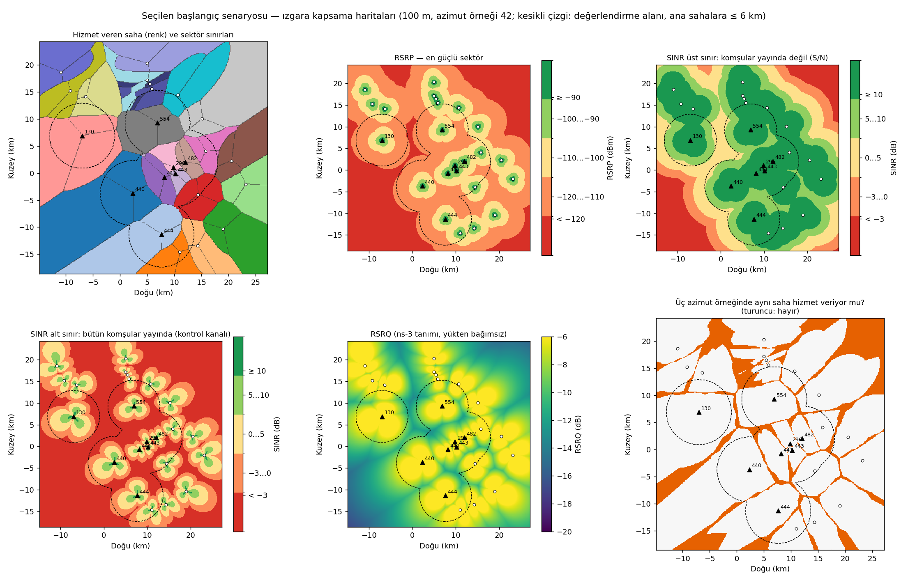

# Izgara kapsama haritaları — 15 Kasım 2026

**Amaç:** Hocanın notundaki "önce bir coverage belli olsun" isteği ve taslaktaki 6. adım (M2): seçilen
başlangıç senaryosunda bölge genelinde hangi noktaya hangi sektörün hizmet verdiği, RSRP, SINR ve
zayıf kapsama alanları. Şimdiye kadar yalnız sanal kullanıcı noktalarında ölçüm yapılmıştı.

**Senaryo:** Seçilen ayar (120°, 49 dBm, log-distance n=3, gölgeleme yok, Band 3 / 20 MHz, tek taşıyıcı,
saha başına 3 sektör), güncel envanterden 24 saha. Izgara 100 m; sahaların 4 km çevresi.
Değerlendirme alanı: ana sekiz sahadan herhangi birine ≤ 6 km (sanal kullanıcı yerleşim aralığı), 549 km².

## Yöntem ve doğrulama

Yüz binlerce ızgara noktasını ns-3'te kullanıcı olarak koşturmak mümkün değil. Bu yüzden ns-3 senaryosunun
radyo hesabı analitik olarak yeniden yazıldı ([radio_model.py](radio_model.py)): aynı anten deseni,
yayılım modeli, güç ve gürültü. Hiçbir harita, ns-3 ile karşılaştırılmadan çizilmedi. Kabul ölçütleri
karşılaştırmadan önce yazıldı ([validate.py](validate.py), [validate_fresh.py](validate_fresh.py)).

| Büyüklük | ns-3 ile karşılaştırma (12 koşu, 3 072 kullanıcı) | Sonuç |
|---|---|---|
| Hizmet veren sektör | %100 aynı | ✅ haritalandı |
| RSRP, RSRQ | en büyük fark 0,000 dB | ✅ haritalandı |
| S/N (komşular yayında değil) | en büyük fark 3·10⁻⁹ dB | ✅ SINR üst sınırı olarak haritalandı |
| Kontrol kanalı SINR (bütün komşular yayında) | en büyük fark 2·10⁻⁹ dB | ✅ SINR alt sınırı olarak haritalandı |
| Yüklü veri kanalı SINR (KPI yükünde) | en iyi yöntemde medyan fark 0,6–2,3 dB, saha farkı 1,3–4,7 dB | ❌ ölçütü geçmedi, haritalanmadı |

Gerçek yük altındaki SINR, her noktada haritadaki alt ve üst sınır arasındadır.

### Doğrulama sırasında bulunan iki ns-3 davranışı

Yüklü SINR'nin analitik olarak tutturulamamasının nedenleri araştırıldı. İkisi de önceki bulguların
yorumunu etkiliyor:

1. **ns-3'ün raporladığı mixed SINR, girişimsiz örneklerle karışık.** Örneklerin yalnız ≈%32–41'inde
   taze veri kanalı girişimi var. Kalan örneklerde ns-3 girişimi hiç kullanmıyor ve değer birebir S/N
   (fark 10⁻¹⁴ dB). Girişimli örnek oranı hizmet veren sektörün doluluğuyla ilişkili (r = 0,62).
   Raporlanan kullanıcı SINR'si bu iki tür örneğin dB ortalaması.
2. **Yük çalışmasında komşu sektörlerin yayınları eşzamanlı.** Yük kullanıcılarının UDP kaynakları aynı
   anda başlıyor ve tek tip yük düzeylerinde aynı aralıkla paket gönderiyor. Bu yüzden komşu sektörler
   aynı alt çerçevelerde birlikte yayın yapıyor. Girişimli örneklerde ns-3 SINR'si, bağımsız yayın
   varsayan analitik hesaptan 2–6 dB düşük. Fark tek tip düzeylerde (L1, L2) büyük, sahaya özel
   aralıklı düzeyde (L3) küçük.

**Önceki bulgulara etkisi:** Gerçekçi yükte SINR farkının kapanması (4,74 → 1,44–1,72 dB) gerçek bir
yük etkisi. Ama bu sayı, ns-3'ün bu SINR'yi nasıl ortaladığına ve yük trafiğinin eşzamanlılığına
bağlı. Experia SINR'sinin tanımı bilinmeden "eşleşti" denmemeli. Yük çalışmasının nitel sonucu
korunuyor: düşük yük SINR'yi iyimser gösteriyordu. Sayısal yakınlık ise ölçüm tanımına duyarlı.
Sonraki yük deneylerinde UDP başlangıçları rastgele kaydırılmalı ve girişimli/girişimsiz SINR ayrı
raporlanmalı.

## Haritalar

Etkileşimli sürüm: [kapsama_haritasi.html](kapsama_haritasi.html). Gerçek harita zemini üzerinde RSRP,
SINR sınırları, hizmet alanları ve sahalar katman olarak açılıp kapatılabiliyor; çevrimdışı da çalışıyor.
Saha noktalarının üzerine gelince Experia RSRP/SINR değerleri görünüyor.

## Değerlendirme alanında alan payları (549 km², üç azimut örneği)

| | Örnek 42 | Örnek 7 | Örnek 99 |
|---|---:|---:|---:|
| RSRP < −120 dBm | %0,2 | %0,2 | %0,2 |
| RSRP −120…−110 dBm | %51,9 | %52,3 | %51,6 |
| RSRP −110…−100 dBm | %35,6 | %35,1 | %35,9 |
| RSRP ≥ −100 dBm | %12,4 | %12,4 | %12,4 |
| Medyan RSRP | −110,4 dBm | −110,4 dBm | −110,3 dBm |
| SINR üst sınır (S/N) < 0 dB | %0 | %0 | %0 |
| Medyan S/N | 12,9 dB | 12,8 dB | 13,0 dB |
| SINR alt sınır (tam girişim) < −3 dB | %30,8 | %31,6 | %30,1 |
| SINR alt sınır < 0 dB | %60,4 | %61,5 | %60,6 |
| Medyan kontrol kanalı SINR | −1,1 dB | −1,2 dB | −1,1 dB |

Üç azimut örneğinde değerlendirme alanının **%90,6'sında aynı saha** hizmet veriyor. Sınır şeritleri
anten yönü varsayımına bağlı (haritada turuncu), ama genel hizmet alanları değil.

### Ana sahaların hizmet alanında RSRP ve Experia

| Saha | Bölüm | Haritada hizmet alanı (km², örnek 42) | Hizmet alanında medyan RSRP | Experia RSRP | Fark |
|---|---|---:|---:|---:|---:|
| SITE_000130 | eğitim | 96,5 | −113,3 | −111,9 | −1,4 |
| SITE_000296 | eğitim | 18,4 | −108,7 | −103,7 | −5,0 |
| SITE_000440 | kontrol | 89,4 | −112,8 | −112,2 | −0,6 |
| SITE_000441 | kontrol | 36,9 | −109,4 | −102,8 | −6,6 |
| SITE_000443 | kontrol | 11,0 | −102,1 | −101,3 | −0,9 |
| SITE_000444 | eğitim | 68,6 | −111,7 | −115,3 | +3,6 |
| SITE_000482 | eğitim | 22,2 | −104,8 | −99,3 | −5,5 |
| SITE_000554 | eğitim | 67,4 | −111,0 | −105,6 | −5,3 |

Bu tablo betimleyicidir. Experia ölçümleri gerçek kullanıcıların bulunduğu yerlere ağırlıklıdır;
harita ise alanı eşit ağırlıklandırır. Kullanıcı noktalarıyla yapılan önceki karşılaştırmalarla aynı
yönü gösteriyor: 441, 482 ve 554 simülasyonda zayıf, 444 güçlü.

## Yorum

- **RSRP açısından bölgede kapsama boşluğu yok.** Değerlendirme alanının %99,8'inde RSRP ≥ −120 dBm,
  yaklaşık yarısında −120…−110 dBm aralığında (kırsal, saha aralığı geniş). Hizmet alanları geniş ve
  azimut varsayımına az duyarlı.
- **Ağ girişim sınırlı.** Komşular hiç yayın yapmazken her yerde S/N > 0 dB. Bütün komşular yayındayken
  alanın %60'ında SINR < 0 dB. Gerçek SINR bu iki sınır arasında ve yüke göre yer değiştiriyor.
  Bu, tek taşıyıcı ve tüm sektörlerin aynı frekansta olduğu varsayımının sonucu. Gerçek ağda birden fazla
  taşıyıcı varsa girişim daha düşük olur. Çok taşıyıcılı senaryo (S2) bu yüzden önemli bir açık konu.
- **Kapsama sınırlarını doğrudan veriden doğrulayamıyoruz.** Anten yönü, eğimi ve arazi bilinmiyor.
  Haritalar varsayımsal senaryonun çıktısıdır; operatör kapsama haritası değildir.

## Sınırlar

- Düz zemin, arazi/bina yok; gölgeleme kapalı (seçilen ayar). Gerçek kapsama arazi nedeniyle daha parçalı olur.
- Anten yalnız yatay desenli; eğim (downtilt) yok. Saha yakınındaki değerler bu yüzden iyimser.
- Haritanın dış kenarlarında ötesinde saha yok. Dış bölgedeki zayıf değerler senaryo sınırının sonucudur, yorumlanmamalı.
- Yüklü SINR haritalanmadı; yalnız ns-3 ile birebir aynı çıkan sınırlar gösterildi.

[Analitik model](radio_model.py) — [Doğrulama](validation.json) — [Girişimli örnek doğrulaması](validation_fresh.json) —
[Haritalar](maps.py) — [Alan istatistikleri](coverage_stats.json)
