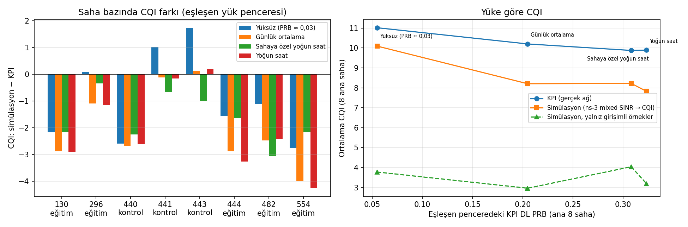

# CQI karşılaştırması — 15 Kasım 2026

**Amaç:** Taslağın trafik aşamasındaki "CQI/throughput dağılımlarını karşılaştır" adımı. Throughput birimleri
doğrulanmadığı için birimsiz CQI (0–15) kullanıldı. Yük çalışmasında yükü PRB'ye göre ayarlamıştık; CQI
ayarlanmadı, bu yüzden bağımsız bir kontrol. Ayrıca CQI ve PRB **aynı KPI kaydından** geliyor. Yani bu,
Experia karşılaştırmasının aksine **eşzamanlı** bir karşılaştırma: aynı saatlerin yükü ve CQI'sı.

## Yöntem

Kurallar koşulardan önce yazıldı ([compare.py](compare.py)); hiçbir parametre CQI'ya göre ayarlanmadı.

- **Simülasyon CQI'sı:** ns-3.44'ün kendi `LteAmc` sınıfı (varsayılan Vienna/MI hata modeli) ile
  SINR→CQI tablosu üretildi ([tools/cqi_table.cc](tools/cqi_table.cc), −20…+40 dB, 0,01 dB adım). Kanal düz
  olduğu için bütün kaynak blokları aynı CQI'yı veriyor. Tablo, kullanıcı cihazının CQI hesapladığı
  SINR örneklerine (yük çalışmasının kayıtları, 256 ölçüm kullanıcısı, 3 örnek) uygulandı.
  Kullanıcı → sektör → saha ortalaması alındı.
- **KPI CQI'sı:** `Avg_CQI_ERI`, ana 8 sahanın hücreleri, normal günler (deprem pencereleri hariç).
  Hücre ortalaması → saha ortalaması.
- **Yük eşleştirmesi:**

| Simülasyon | KPI penceresi |
|---|---|
| Yüksüz (PRB ≈ 0,03) | En düşük PRB saati (06:00) |
| Günlük ortalama | Bütün gün |
| Sahaya özel yoğun saat | 20:00–23:45 |
| Yoğun saat | 21:00–21:45 |

## Sonuçlar

| Yük | KPI ort. CQI | Simülasyon ort. CQI | Fark (sim − KPI) | Saha MAE | Saha sıralaması (Spearman) | Yalnız girişimli örnekler: fark |
|---|---:|---:|---:|---:|---:|---:|
| Yüksüz ↔ gece | 11,02 | 10,10 | −0,92 | 1,63 | 0,52 | −7,24 |
| Günlük ortalama ↔ bütün gün | 10,20 | 8,21 | −2,00 | 2,03 | 0,43 | −7,24 |
| Sahaya özel ↔ 20–24 | 9,88 | 8,22 | −1,66 | 1,66 | 0,57 | −5,84 |
| Yoğun saat ↔ 21:00 | 9,89 | 7,83 | −2,07 | 2,12 | 0,33 | −6,70 |

Gece → yoğun saat CQI düşüşü: KPI'da **−1,12**, simülasyonda **−2,22**.

Saha bazında sayılar: [cqi_site_comparison.csv](cqi_site_comparison.csv).

## Yorum

1. **Simülasyon, gerçek ağdan daha düşük CQI veriyor ve yüke iki kat duyarlı.** Yüksüzken fark küçük
   (−0,9). Yük arttıkça açılıyor (−2,0). Gerçek ağda CQI yükle yalnız ≈1 birim düşerken simülasyonda
   ≈2 birim düşüyor.
2. **Simülasyondaki fiziksel girişim gerçek ağa göre çok güçlü.** ns-3'ün raporladığı CQI'nın çoğu
   girişimsiz örneklerden geliyor (kapsama haritaları çalışmasında bulunan davranış). Yalnız girişimli
   örneklere bakınca CQI ≈3–4: gerçek ağdan 6–7 birim düşük. Gerçek ağ, yoğun saatte bile CQI ≈10'u
   koruyor; ns-3 tablosunda bu yaklaşık 10–11 dB SINR'ye karşılık geliyor. Bu, tek taşıyıcı ve bütün sektörlerin aynı
   frekansta olduğu varsayımının girişimi abarttığına güçlü bir işaret. Yük çalışmasındaki eşzamanlı yük
   trafiği de girişimli örnekleri kötüleştiriyor.
3. **Saha sıralaması zayıf tutuyor** (Spearman 0,33–0,57). Simülasyon hangi sahanın daha iyi CQI'ya
   sahip olduğunu ancak kısmen yakalıyor. 554 ve 482'de simülasyon belirgin düşük. 554'ün KPI yükü çok
   düşük ve CQI'sı yüksek; bu sahada da üç sektör / tek taşıyıcı varsayımı uymuyor görünüyor.
4. **Experia SINR yakınlığıyla birlikte okununca:** Gerçekçi yükte Experia SINR'sine yaklaşan sonuç,
   ns-3'ün girişimsiz örnekleri de ortalamaya katmasına dayanıyordu. Eşzamanlı KPI CQI'sı ise
   simülasyonun girişimi fazla gösterdiğini söylüyor. İki bulgu çelişmiyor: simülasyondaki "ortalama
   SINR" doğru düzeye yakın ama yanlış nedenle. Girişim çok güçlü, bunu girişimsiz örneklerin çokluğu
   dengeliyor.

**Sonuç:** CQI kontrolü, çok taşıyıcılı / frekans planlı senaryonun (taslaktaki S2) ilk aşama için gerekli
olduğunu gösteriyor. Tek taşıyıcılı senaryo RSRP ve kapsama için uygun. Ama yük ve kapasite deneyleri
için girişimi abartıyor. Bu yüzden stres testinden önce S2 denenmeli.

## Sınırlar

- KPI `Avg_CQI_ERI` tanımı (raporlama türü, ağırlıklandırma) ve ağın 64QAM (tablo 1) mı 256QAM (tablo 2)
  CQI tablosu mu kullandığı bilinmiyor. ns-3 tablo 1 kullanıyor. Ağ tablo 2 kullanıyorsa aynı CQI daha
  yüksek SINR'ye karşılık gelir ve fark daha da büyür.
- Simülasyon CQI'sı, 97 alt çerçevede bir alınan SINR örneklerinden hesaplandı; bütün CQI raporları değil.
- Simülasyon CQI'sı ns-3'ün mixed SINR davranışını ve yük çalışmasının eşzamanlı yük trafiğini içeriyor.
- KPI 2025 yılına ait; ana sahaların hücre sayısı ile simülasyondaki sektör sayısı farklı (ör. 443: 14 hücre, 3 sektör).

[SINR→CQI aracı](tools/) — [CQI tablosu](cqi_table.csv) — [Karşılaştırma](compare.py) — [Sonuç](cqi_result.json)
