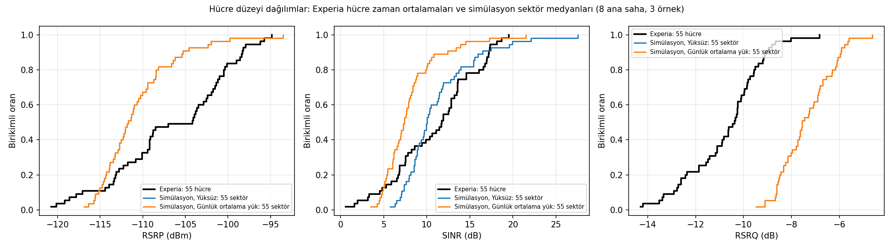

# Dağılım ve sıralama karşılaştırması — 15 Kasım 2026

**Amaç:** Taslağın doğrulama bölümündeki öneri: tek bir ortalamaya güvenmeden dağılım farklarını (yüzdelikler),
saha düzeyi hataları ve sahaların sıralamasının kararlılığını raporlamak. Şimdiye kadar yalnız saha
ortalamalarının hatası (MAE) raporlanmıştı. Yeni koşu yapılmadı; mevcut sonuçlar kullanıldı.

## Yöntem

Kurallar karşılaştırmadan önce yazıldı ([compare.py](compare.py)).

- **Aynı düzeyde karşılaştırma.** Experia değerleri, bir hücrenin bir saatlik medyanlarının ortalaması;
  yani hücre düzeyinde merkezî bir değer. Bu yüzden tek tek kullanıcılarla değil, hücre/sektör değerleriyle
  karşılaştırıldı:
  - **Experia:** 8 ana sahanın 55 hücresinin dönem ortalaması. Saha hedefleri de bu tablodan geliyor.
  - **Simülasyon:** ana sahalardaki her sektörün ölçüm kullanıcılarının medyanı. En az 3 kullanıcısı olan
    sektörler, 256 kullanıcı, 3 örnek birlikte (55 sektör).
- **Koşular:** yüksüz ve günlük ortalama yük (KPI). Yeni koşu yok.
- Yüzdelikler (%10/25/50/75/90), Kolmogorov–Smirnov uzaklığı (KS, 0 = aynı, 1 = tamamen ayrık),
  saha içi yayılım (sahadaki hücre/sektör değerlerinin standart sapması), saha sıralama korelasyonu
  (Spearman). Hücre sayısı sahadan sahaya 2–14 değiştiği için her sahaya eşit ağırlık veren sürüm de
  hesaplandı; sonuçlar değişmedi.
- Eşik yok; taslak da tanımlar doğrulanmadan sayısal kabul eşiği koymamayı öneriyor.

## Sonuçlar

RSRP ve RSRQ grafiklerinde yüksüz (mavi) ve yüklü (turuncu) eğriler üst üste: ns-3'te bu iki metrik yükten
bağımsız.

### Hücre düzeyi dağılım (dB / dBm)

| Metrik | Kaynak | %10 | %25 | Medyan | %75 | %90 | Çeyrekler arası | KS |
|---|---|---:|---:|---:|---:|---:|---:|---:|
| RSRP | Experia | −116,0 | −112,0 | −104,2 | −101,1 | −98,3 | 10,9 | |
| | Simülasyon (yükten bağımsız) | −115,2 | −113,9 | −111,7 | −108,6 | −105,3 | 5,3 | 0,44 |
| SINR | Experia | 4,7 | 7,2 | 11,8 | 14,1 | 17,2 | 6,9 | |
| | Simülasyon, yüksüz | 7,2 | 8,6 | 10,0 | 13,0 | 16,3 | 4,4 | 0,22 |
| | Simülasyon, günlük ortalama yük | 4,9 | 6,0 | 7,4 | 8,7 | 11,8 | 2,7 | 0,45 |
| RSRQ | Experia | −12,8 | −11,7 | −10,4 | −9,8 | −9,1 | 2,0 | |
| | Simülasyon (yükten bağımsız) | −8,6 | −8,3 | −7,6 | −6,6 | −5,9 | 1,7 | 0,89 |

### Saha içi yayılım ve saha sıralaması

| Metrik | Saha içi std: Experia / simülasyon | Sıralama korelasyonu sim–Experia (örnek 42 / 7 / 99) | Örnekler arası sıralama kararlılığı |
|---|---:|---|---|
| RSRP | 4,9 / 2,3 dB | 0,79 / 0,90 / 0,95 | 0,81–0,90 |
| SINR (yüksüz) | 3,8 / 2,2 dB | 0,48 / 0,60 / 0,93 | 0,64–0,76 |
| SINR (günlük ortalama yük) | 3,8 / 2,1 dB | 0,50 / 0,60 / 0,88 | 0,57–0,76 |
| RSRQ | 1,4 / 0,9 dB | −0,33 / −0,50 / −0,45 | 0,12–0,60 |

## Yorum

1. **RSRP: sahaların sıralaması iyi, ama hücre dağılımı dar ve zayıf tarafa kaymış.** Hangi sahanın güçlü,
   hangisinin zayıf olduğunu simülasyon iyi yakalıyor (korelasyon 0,79–0,95). Ama Experia'da −95…−101 dBm'lik
   güçlü hücreler bol, simülasyonda yok. Medyan 7,5 dB düşük, yayılım yarı yarıya. Saha ortalamaları önceki
   karşılaştırmalarda yakın görünüyordu (kontrol MAE ≈ 1,7–3 dB). Bunun bir kısmı, sektörlerin eşit
   ağırlıkla ortalanmasından: az kullanıcılı, sahaya yakın bir sektör saha değerini yükseltebiliyor
   (örneğin 296'da tek kullanıcılı sektör −94 dBm). Taslağın "yalnız bölgesel ortalamaya uydurmayın"
   uyarısı burada somutlaşıyor.
2. **Gerçek ağda aynı sahanın hücreleri arasında fark büyük** (RSRP'de 4,9 dB, simülasyonda 2,3 dB). Bu,
   farklı frekans bantlarında taşıyıcılar olduğu fikriyle uyumlu: düşük bant daha güçlü RSRP verir. CQI
   karşılaştırmasıyla birlikte, çok taşıyıcılı senaryonun (S2) gerekli olduğuna üçüncü bir işaret.
   Kullanıcıların gerçekte sahalara daha yakın olması (yerleşim yerleri) da etkili olabilir; 2–6 km
   yerleşim varsayımı güçlü hücreleri dışarıda bırakıyor.
3. **SINR: yüksüz simülasyonun dağılımı Experia'ya en yakın** (KS 0,22). Yük eklenince yüksek SINR'li
   hücreler kayboluyor ve dağılım daralıyor (KS 0,45). Saha ortalamasında yükün iyileştirdiği uyum, hücre
   dağılımında görülmüyor. Sıralama orta düzeyde ve örneğe bağlı (0,48–0,93).
4. **RSRQ: simülasyon yaklaşık 3 dB iyimser ve sahaların sıralamasını hiç yakalamıyor** (negatif
   korelasyon). ns-3 RSRQ'yu yükten bağımsız ve farklı bir tanımla hesaplıyor. Gerçek RSRQ, veri trafiğinin
   gücünü de içerir. Bu modelle RSRQ karşılaştırması anlamlı değil; RSRQ'yu kalibrasyon ve kabul
   ölçütlerinden çıkarmayı öneriyoruz.

**Özet:** Mevcut başlangıç senaryosu RSRP'de sahaların göreli durumunu doğru veriyor; bu kapsama
çalışmaları için iyi bir temel. Ama hücre düzeyinde gerçek ağın çeşitliliğini (güçlü/zayıf hücreler,
taşıyıcı katmanları) temsil etmiyor. CQI, kapsama haritası ve bu karşılaştırma aynı yönü gösteriyor:
sıradaki model adımı çok taşıyıcılı senaryo (S2) ve kullanıcı yerleşiminin sahalara yakınlığının yeniden
gözden geçirilmesi olmalı.

## Sınırlar

- Experia (Haziran 2026) ve simülasyon farklı dönemler; Experia değerleri gerçek kullanıcılara ağırlıklı.
- Simülasyonda sektör = varsayımsal anten yönü; Experia hücresi sektör de taşıyıcı da olabilir. Bire bir
  eşleme yok, yalnız dağılımlar karşılaştırıldı.
- En az 3 kullanıcı şartı az kullanıcılı sektörleri dışarıda bırakıyor (bilinçli seçim; tek kullanıcının
  medyanı hücre değeri sayılmamalı).
- Simülasyon SINR'si, kapsama haritaları çalışmasında belgelenen ns-3 mixed SINR davranışını içeriyor.

[Karşılaştırma kodu](compare.py) — [Tam sonuç](distribution_result.json)
