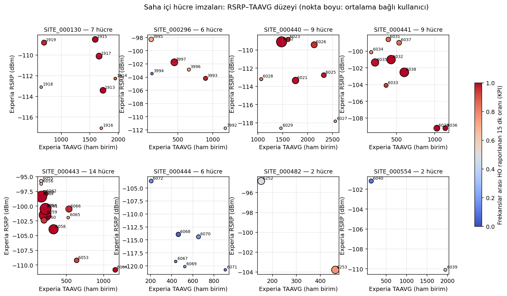

# Saha içi hücre imzası analizi — 15 Kasım 2026

**Amaç:** Taslağın "Radio consistency checks" bölümü ve hocanın kırmızı notu: "bir çok sitede birden fazla
cell var… her cell farklı sector mu frekans mı bilmiyoruz". Aynı sahadaki hücrelerin ölçüm imzalarına
bakarak sektör mü taşıyıcı mı olduklarına dair **ipucu** toplamak ve çok taşıyıcılı senaryonun (S2)
nasıl kurulacağına yön vermek. Yalnız veri analizi; simülasyon yok.

Taslağın uyarısı geçerli: toplu kullanıcı istatistikleri anten yönünü veya bandı **tanımlayamaz**.
Aşağıdakiler kanıt değil, betimleyici ipuçlarıdır.

## Yöntem

Kurallar analizden önce yazıldı ([analyze.py](analyze.py)).

- **Kaynaklar:** 8 ana sahanın 55 hücresi. Experia: saatlik RSRP, SINR, RSRQ ve ham TAAVG (Haziran 2026).
  KPI: 10 günün 15 dakikalık kayıtları (2025), DL PRB, bağlı kullanıcı, CQI, RACH TA ve handover başarı
  oranları.
- **Frekanslar arası handover:** Bir hücrede `Inter_Freq_Hand_Succ_PC` değeri raporlanıyorsa o hücreden
  başka bir LTE frekansına handover denemesi var demektir. Bu, çevrede en az bir başka LTE frekansı
  olduğunu gösterir. Ölçü: değerin raporlandığı 15 dakikalık dilimlerin oranı; %50'nin üstü "var" sayıldı.
- **Düzey grupları:** Düşük bant taşıyıcılar genelde daha uzak kullanıcılara hizmet verir (daha büyük TA).
  Aynı sahada RSRP ve TA düzeyleri belirgin ayrışan hücre grupları taşıyıcı katmanlarına işaret edebilir.
- **Saatlik birlikte değişim:** Aynı sahadaki hücre çiftlerinin saatlik RSRP korelasyonu (Experia) ve
  bağlı kullanıcı paylarının korelasyonu (KPI).

## Sonuçlar

| Saha | Hücre | Frekanslar arası HO olan hücre | RSRP aralığı (dB) | RSRP–TAAVG korelasyonu | İpucu |
|---|---:|---:|---:|---:|---|
| SITE_000130 | 7 | 7 | 8,6 | −0,25 | Çok frekanslı; iki hücre (1918, 1919) belirgin küçük TA ile ayrı grup |
| SITE_000296 | 6 | 4 | 13,5 | −0,82 | Çok frekanslı; büyük TA → zayıf RSRP |
| SITE_000440 | 9 | 7 | 11,6 | −0,26 | Çok frekanslı; bütün hücreler geniş alana hizmet veriyor (büyük TA) |
| SITE_000441 | 9 | 9 | 10,6 | −0,84 | Çok frekanslı; 2 hücre (6030, 6036) uzak/zayıf grup, 7 hücre yakın/güçlü grup |
| SITE_000443 | 14 | 14 | 15,1 | −0,84 | Çok frekanslı; 2 hücre (6053, 6064) uzak/zayıf grup, 12 hücre yakın/güçlü grup |
| SITE_000444 | 6 | **0** | 17,1 | −0,72 | **Tek LTE frekansı** görünüyor; 3 hücre çok az gözlem ve kullanıcıya sahip |
| SITE_000482 | 2 | 1 | 8,9 | — | Belirsiz |
| SITE_000554 | 2 | **0** | 8,9 | — | **Tek LTE frekansı** görünüyor; biri uzak (TAAVG 1 946), biri yakın (132) |

Hücre bazında tablo: [cell_signatures.csv](cell_signatures.csv); hücre çiftleri: [cell_pairs.csv](cell_pairs.csv);
saha özeti: [site_summary.csv](site_summary.csv).

**Saatlik birlikte değişim bilgi vermedi.** Hücre çiftlerinin saatlik RSRP korelasyonunun saha medyanları
−0,15…0,20, kullanıcı payı korelasyonları ≈0. Experia'nın saatlik değerleri bu ayrımı yapamayacak kadar
gürültülü ya da kullanıcı karışımına bağlı.

## Yorum

1. **Ana sahaların beşi (130, 296, 440, 441, 443) çok frekanslı.** Hücrelerin hemen hepsinde frekanslar
   arası handover düzenli raporlanıyor. Hücre sayıları da (6, 7, 9, 9, 14) "3 sektör × birden fazla
   taşıyıcı" yapısıyla uyumlu. Bu sahaları tek taşıyıcı 3 sektörle modellemek, CQI ve dağılım
   çalışmalarında görülen aşırı girişimin ve dar hücre dağılımının olası nedeni.
2. **441 ve 443'te iki katmanlı bir yapı göze çarpıyor.** İki hücre uzak kullanıcılara hizmet veriyor ve
   zayıf (TAAVG ≈ 600–1 150, RSRP ≈ −109…−111). Diğerleri yakın ve güçlü (TAAVG ≈ 160–600,
   RSRP ≈ −96…−104). Bu, bir kapsama katmanı ile bir/birkaç kapasite katmanı ayrımına benziyor. Ama bandı
   veya yönü bu veriden söyleyemeyiz.
3. **444 ve 554'te frekanslar arası handover yok; tek LTE frekansı olası.** 554'ün iki hücresi büyük
   olasılıkla iki farklı yöne bakan sektör: biri yakın, biri çok uzak kullanıcılara hizmet veriyor. Bu,
   554 için 3 sektör yerine 2 sektör (S1) varsayımını destekliyor. 554, şimdiye kadarki bütün
   karşılaştırmalarda en çok sapan sahaydı. 444'ün altı hücresinden üçü çok az gözlem ve kullanıcıya sahip
   (18–47 saat); gerçek yapısı belirsiz.
4. **Experia TAAVG ile KPI RACH TA aynı yönü gösteriyor** (çoğu sahada büyük TA ↔ zayıf RSRP). TAAVG
   biriminin hâlâ doğrulanmadığını, değerlerin yalnız sıralama için kullanıldığını not ediyoruz.

## Çok taşıyıcılı senaryo (S2) için öneri

| Saha grubu | Önerilen model |
|---|---|
| 130, 296, 440, 441, 443 (çok frekanslı) | Saha başına 3 sektör × 2 taşıyıcı: bir kapsama katmanı (düşük bant, ör. Band 20, 800 MHz) ve bir kapasite katmanı (Band 3, 1 800 MHz). Hücreler katmanlara TA/RSRP düzeyine göre eşlenir. |
| 554 | Tek taşıyıcı, 2 sektör (S1). |
| 444 | Tek taşıyıcı, 3 sektör (mevcut). |
| 482 | Belirsiz; iki alternatif birlikte denenir. |
| Komşu sahalar | Aynı analiz komşular için de yapılmalı; o zamana kadar 2 taşıyıcı varsayımı. |

**ns-3 notu:** Klasik LTE modülünde her taşıyıcı aynı konumda ayrı bir eNB cihazıdır. Kullanıcı ilk
bağlanmada yalnız kendi ayarlı frekansını arar; frekanslar arası ilk seçim otomatik değildir. Bu yüzden
kullanıcıların taşıyıcılara bölünmesi (ör. KPI kullanıcı paylarına göre) açık bir varsayım olarak
belirlenmeli. Bant ataması Turkcell'den teyit edilebilirse en güvenilir yol odur. Hocaya sorulacak:
"Hücrelerin bant/EARFCN bilgisi ya da en azından hangi hücrelerin aynı sektörde olduğu paylaşılabilir mi?"

## Sınırlar

- Experia (2026) ve KPI (2025) farklı dönemler. Hücre kimlikleri iki kaynakta ortak, ama dönemler
  arasında konfigürasyon değişmiş olabilir.
- Handover göstergesi bir yönü kanıtlar (çevrede başka frekans var). Başka frekansın aynı sahada mı,
  komşu sahada mı olduğunu ayırt etmez.
- TAAVG birimi doğrulanmadı; yalnız göreli sıralama kullanıldı.
- Hücre sayısı az olan sahalarda (482, 554) korelasyonlar hesaplanamadı.

[Veri çıkarımı](extract.py) — [Analiz](analyze.py)
