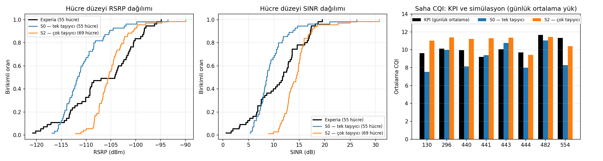

# Çok taşıyıcılı senaryo (S2) — 15 Kasım 2026

**Amaç:** Taslaktaki S2 hipotezi: bazı sahalar aynı yönde birden fazla frekans katmanına sahip. CQI, dağılım
ve hücre imzası çalışmaları, tek taşıyıcılı modelin (S0) girişimi abarttığını ve gerçek ağın hücre
çeşitliliğini temsil etmediğini göstermişti. Bu çalışma S2'yi kurup S0 ile aynı koşullarda karşılaştırıyor.

## Kurulum

Tasarım koşulardan önce yazıldı ([prepare.py](prepare.py), [plan.json](plan.json)).

**İki senaryoda ortak olanlar:**
- seçilen radyo ayarı, güncel 24 saha, üç azimut/kullanıcı örneği, 256 ölçüm kullanıcısı;
- her hücreye bir yük kullanıcısı; hedef KPI günlük ortalama PRB (0,233);
- 4 s koşu, 1 s ısınma.

**İkisinde de yeni:** UDP trafiği her kullanıcı için kendi aralığı içinde rastgele bir anda başlıyor.
Kapsama haritaları çalışmasında bulunan eşzamanlı yük yapaylığı böylece kaldırıldı. Bu yüzden S0 de
yeniden koşuldu; önceki sonuçlar kullanılmadı.

**Senaryolar:**

| | S0 | S2 |
|---|---|---|
| Taşıyıcı | Bütün sahalarda 1 800 MHz (Band 3, 20 MHz) | KPI'da hücrelerinin çoğu frekanslar arası handover raporlayan 17 sahada ek olarak 800 MHz (Band 20, 10 MHz); diğer 7 sahada yalnız 1 800 MHz |
| Sektör | Her sahada 3 | 554'te 2 (hücre imzası ipucu), diğerlerinde 3 |
| Hücre sayısı | 72 | 122 |
| 800 MHz gücü | — | Taşıyıcı başına aynı 49 dBm (varsayım) |
| 800 MHz yayılımı | — | Aynı log-distance yasası + serbest uzay referans farkı (+7,05 dB) |
| Kullanıcı ataması | Hepsi 1 800 MHz | En iyi 1 800 MHz RSRP ≥ −110 dBm ise 1 800 MHz, değilse 800 MHz (varsayım) → ölçüm kullanıcılarının %50–55'i 800 MHz'de |

Tek frekanslı görülen sahalar: 444, 554, 445, 480, 553, 555. 549'un KPI kaydı yok, tek frekans sayıldı.
Bkz. [site_frequency_hints.csv](site_frequency_hints.csv).

**Yazılım doğrulaması:** Çok taşıyıcı desteği eklenen ns-3 senaryosu, yeni sütunlar olmadan ve kullanıcı
başına frekans atamasıyla önceki sonuçları dosya düzeyinde birebir üretti. İki katmanlı küçük testte
800 MHz kullanıcıları 800 MHz hücrelerine bağlandı; RSRP farkı beklendiği gibi +10,07 dB çıktı
(7,05 frekans + 3,01 yarı bant genişliği).

**Yük kalibrasyonu:** Katsayı yalnız 701 örneğinde bulundu, sonra donduruldu ([calibration/](calibration/)).
Oluşan ortalama PRB: S0 0,254 / 0,259 / 0,249; S2 0,225 / 0,227 / 0,222. Hedef 0,233; 701'de S0 için
×1,09, S2 için ×0,97.

## Sonuçlar

| Gösterge | S0 — tek taşıyıcı | S2 — çok taşıyıcı | Gerçek ağ |
|---|---:|---:|---:|
| **Experia saha hatası (kontrol MAE)** RSRP / SINR / RSRQ | **1,72** / **2,15** / 4,30 | 3,03 / 4,51 / 4,26 | |
| Experia saha hatası (eğitim MAE) RSRP / SINR / RSRQ | 3,59 / **2,57** / **2,46** | 3,91 / 4,09 / 3,26 | |
| Saha RSRP sıralaması (Spearman, 3 örnek) | **0,79 / 0,90 / 0,95** | 0,86 / 0,64 / 0,43 | |
| Hücre RSRP medyanı (dBm) | −111,7 | **−105,5** | −104,2 |
| Hücre RSRP çeyrekler arası (dB) | 5,3 | 4,1 | 10,9 |
| Hücre SINR medyanı (dB) | 8,6 | 14,4 | 11,8 |
| KPI CQI farkı (sim − KPI, günlük) | −1,06 | **+0,73** | 10,20 |
| KPI CQI saha MAE | 1,28 | **1,09** | |
| Yalnız girişimli örneklerde CQI farkı | −4,32 | **−3,55** | |

Saha bazında işaretli farklar ve bütün sayılar: [comparison.json](comparison.json).

## Yorum

1. **S2 bazı düzeyleri gerçeğe yaklaştırıyor.** Hücre RSRP medyanı Experia ile neredeyse aynı (−105,5 ve
   −104,2 dBm; S0'da −111,7). Ortalama CQI düzeyi KPI'ya biraz daha yakın, girişimli örneklerde fark azaldı.
   Girişimin katmanlara bölünmesi beklendiği gibi etkili.
2. **Ama saha düzeyinde S0'dan kötü.** Saha ortalaması hataları büyüdü (kontrol RSRP 1,7 → 3,0; SINR
   2,2 → 4,5 dB), sahaların RSRP sıralaması zayıfladı. Çok taşıyıcılı sahaların çoğunda RSRP ve SINR
   artık Experia'nın 5–6 dB üstünde (130, 440). 444 tek taşıyıcılı olduğu hâlde ortalaması yükseldi:
   zayıf kullanıcıları komşu sahaların 800 MHz hücrelerine geçtiği için 444'te yalnız güçlü kullanıcılar kaldı. Dağılımın genişliği de düzelmedi: gerçek ağdaki
   güçlü/zayıf hücre ayrışması (çeyrekler arası 10,9 dB) S2'de de yok (4,1 dB).
3. **Sapmanın büyük kısmı iki varsayımdan geliyor; ikisi de veriyle belirlenemedi:**
   - **800 MHz gücü:** Aynı toplam gücün yarı genişlikteki banda verilmesi kaynak elemanı başına +3 dB
     getiriyor. Frekans avantajıyla birlikte 800 MHz hücreleri 10 dB daha güçlü. Operatörler düşük banda
     genelde daha az güç verir.
   - **Kullanıcı atama eşiği (−110 dBm):** Uzak kullanıcıların yarısını 800 MHz'e taşıyor. Bunlar orada
     daha güçlü sinyal ve daha az girişim görüyor.

   Bu iki varsayım sonuçlara bakılarak değiştirilmedi. Değiştirilirse ayrı bir duyarlılık çalışması olarak
   yapılmalı. Bant/güç bilgisi Turkcell'den alınabilirse en sağlam yol odur.
4. **Yan bulgu: eşzamanlı yük yapaylığı kaldırılınca S0'ın CQI farkı yarıya indi** (−2,0 → −1,06).
   Yük çalışmasındaki eşzamanlı trafik CQI ve SINR'yi gerçekten kötüleştiriyormuş. Aynı nedenle S0'ın
   kontrol SINR hatası 1,44 → 2,15 dB oldu: önceki "yakınlık" kısmen bu yapaylıktan geliyordu.
5. **RSRQ iki senaryoda da ≈4,3 dB uzak.** ns-3 RSRQ tanımı yükten bağımsız; taşıyıcı yapısı bunu düzeltmiyor.

## Karar önerisi

- **S2 bu haliyle yeni başlangıç senaryosu olarak benimsenmemeli.** S0, Experia'ya göre saha düzeyinde
  hâlâ daha iyi ve daha tutarlı. S2'nin üstün olduğu yerler (hücre RSRP düzeyi, CQI düzeyi) iki
  doğrulanmamış varsayıma bağlı.
- **Yük ve kapasite deneyleri için girişimin iki uç senaryosu birlikte kullanılabilir:** S0 (tek taşıyıcı,
  girişim fazla) ve S2 (çok taşıyıcı, girişim az). Sonuçlar ikisinde de aynı yöndeyse sağlam kabul edilir.
  Bu, taslağın "sonuçlar hipotezler arasında sürüyor mu raporlayın" önerisine uyuyor.
- **Bundan sonraki bütün yük deneylerinde UDP başlangıcı rastgele kaydırılmalı.**
- **Hocaya/Turkcell'e sorulacak:** hücrelerin bandı/EARFCN'i ve taşıyıcı başına güç; hangi hücrelerin
  aynı sektörde olduğu.

## Sınırlar

- 800 MHz gücü, bant genişliği (10 MHz), anten deseni (1 800 MHz ile aynı) ve kullanıcı atama eşiği varsayım.
- Gerçek katman eşlemesi bilinmiyor; 17 sahaya aynı iki katmanlı yapı verildi. Hücre sayısı 6–18 olan
  sahalarda gerçekte daha fazla katman olabilir.
- ns-3 kullanıcıları ilk bağlanmada farklı frekansları aramıyor; atama sabit ve koşu boyunca değişmiyor.
- Bütün sonuçlar kısa (4 s), sabit kullanıcılı, düşük–orta yük koşularıdır.

[Hazırlık](prepare.py) — [Koşu](study.py) — [Karşılaştırma](summarize.py) — [Sonuçlar](result.json) —
[ns-3 senaryosu](simulation/sindirgi_baseline.cc)
