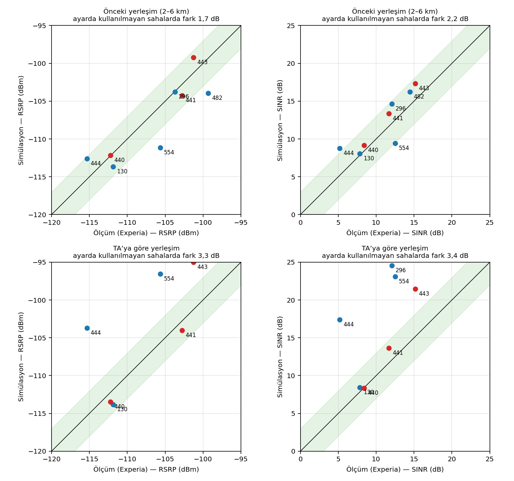
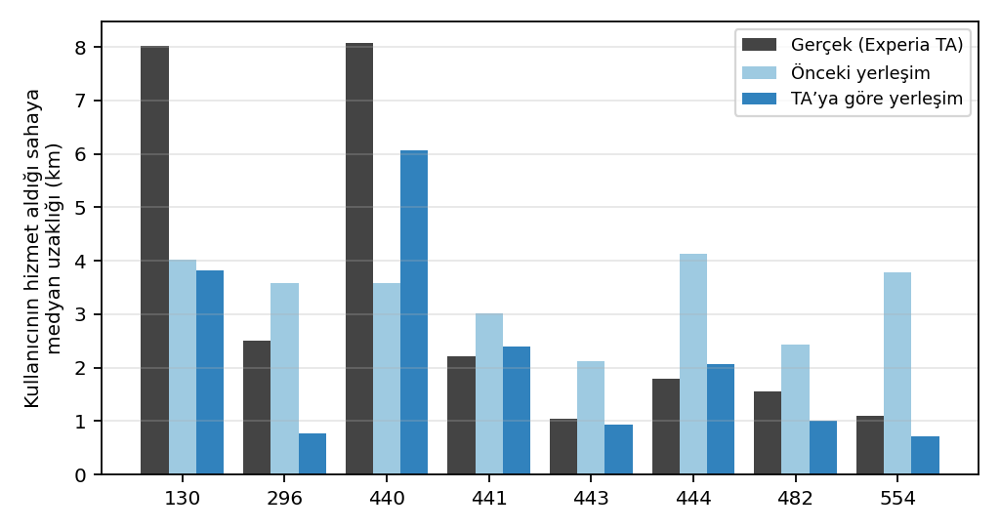

# Kullanıcıları TA'ya göre yerleştirme — 16 Kasım 2026

**Soru:** Sanal kullanıcıları gerçek kullanıcıların kulelere uzaklığına (TA) göre yerleştirirsek simülasyon
Experia'ya yaklaşır mı?

**Kurulum:** Hocanın verdiği birimle Experia TA'sı mesafeye çevrildi (TA × 4,88 m, 100 m–15 km arası).
Her ana sahanın 32 kullanıcısı, o sahanın rastgele seçilen bir saatlik Experia kaydındaki TA mesafesine,
rastgele bir yönde yerleştirildi. Bunun dışında her şey önceki temel senaryoyla (S0) aynı: aynı 24 saha,
aynı radyo ayarları, aynı yük ve üç anten yönü örneği. Ayar yeniden yapılmadı. Kural koşulardan önce
yazıldı ([prepare.py](prepare.py)).

İlk denemede 29 saatlik Experia kaydında TA değeri boş olduğu için iki kullanıcının konumu hatalı oluştu;
bu kayıtlar çıkarılıp koşular tekrarlandı (ilk deneme `failed_run/` altında).

## Sonuç: tek başına TA'ya göre yerleştirme uyumu bozdu

| | Önceki yerleşim (2–6 km) | TA'ya göre yerleşim |
|---|---:|---:|
| Ayarda kullanılmayan sahalarda RSRP / SINR farkı (dB) | **1,7 / 2,2** | 3,3 / 3,4 |
| Ayarda kullanılan sahalarda RSRP / SINR farkı (dB) | **3,6 / 2,6** | 8,3 / 9,7 |
| Sahaların RSRP sıralaması (Spearman) | **0,81** | 0,60 |
| Hücre RSRP medyanı (Experia −104,2 dBm) | −111,7 | **−101,2** |
| KPI CQI farkı | −1,06 | +0,57 |

Kullanıcıların uzaklığı çoğu sahada gerçeğe yaklaştı (443, 444, 482, 441):

Ama bu sahalarda simülasyonun sinyali artık gerçeğinden **çok güçlü**: RSRP 6–12 dB, SINR 6–12 dB yüksek
(296, 443, 444, 482, 554). Uzak kullanıcılı sahalarda (130, 440, 441) sonuç değişmedi ve iyi kaldı.

## Bu ne demek

1. **Önceki ayarlar yanlış kullanıcı mesafesini telafi ediyormuş.** Ayarlar (49 dBm güç, gölgeleme yok)
   kullanıcılar 2–6 km'deyken seçilmişti. Gerçek kullanıcılar birçok sahada 1–2 km'de. Gerçek ağda bu
   yakın kullanıcılar yine de −101…−105 dBm civarında sinyal alıyor. Bizim modelde yakın kullanıcı çok
   güçlü sinyal alıyor. Yani modelde, **yakındaki kullanıcının sinyalini zayıflatan bir şey eksik**; önceki
   yerleşimde bu eksiği kullanıcıları uzağa koymak kapatıyordu.
2. **Eksik olan büyük olasılıkla iki şey (doğrulanmadı):**
   - **Bina içi kayıp:** Experia ölçümlerinin çoğu evlerin ve iş yerlerinin içinden geliyor; duvarlar
     sinyali tipik olarak 10–20 dB zayıflatır. Modelde bina içi kayıp yok.
   - **Antenin aşağı eğimi (downtilt) ve dikey deseni:** Modelde anten her yükseklik açısında aynı
     kazancı veriyor. Gerçekte kuleye çok yakın kullanıcı antenin ana demetinin altında kalır ve daha az
     sinyal alır. Taslakta 6° eğim önerilmişti; biz yalnız yatay desen kullandık.
3. **Uzak kullanıcılı sahalar (130, 440) hâlâ yakın mesafede ölçülüyor.** Bu sahaların gerçek kullanıcıları
   8 km uzakta. Simülasyonda o kadar uzağa konan kullanıcılar komşu sahalara bağlandığı için 130 ve 440'ta
   kalan kullanıcılar daha yakında.

## Sonuç ve öneri

TA verisi işe yaradı: modelin neyi yanlış telafi ettiğini gösterdi. Ama **TA'ya göre yerleştirme tek başına
yeterli değil;** bina içi kayıp ve anten eğimi eklenmeden sonucu kötüleştiriyor. Bu yüzden şimdilik temel
senaryo önceki yerleşimle kalıyor.

Sıradaki mantıklı adım: TA'ya göre yerleştirmeyi koruyup modele (a) bina içi kayıp ve (b) anten eğimi /
dikey desen eklemek, sonra yalnız bu iki değeri ayarlamak. Böylece "kullanıcıları uzağa koyarak telafi"
yerine fiziksel olarak açıklanabilen bir model elde edilir.

## Sınırlar

- Experia TA değeri saatlik bir ortalama; tek tek kullanıcıların uzaklık dağılımı daha geniştir.
- Kullanıcıların yönü rastgele (anten yönleri bilinmiyor); yakın sahalarda (296, 441, 443, 482 birbirine
  1–2 km) kullanıcılar kendi sahası yerine komşuya bağlanabiliyor.
- Tek senaryo (S0, tek taşıyıcı) ve üç örnekle yapıldı.

[Hazırlık](prepare.py) — [Koşu](study.py) — [Karşılaştırma](summarize.py) — [Sayılar](comparison.json)
