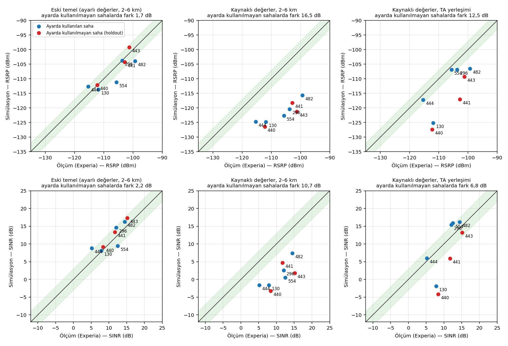

# Kaynaklı (ayarlanmamış) parametrelerle senaryo — 17 Kasım 2026

**Soru:** Hoca, "en iyi uyan değeri değil, gerçek hayattaki değeri kullanın" dedi. Bütün radyo değerlerini
standartlardan ve gözlenen operatör ayarlarından alırsak, hiçbir şeyi ayarlamadan simülasyon Experia'ya ne
kadar yakın kalır?

**Durum: Eski sonuçla kontrol geçti, 6/6 koşu tamamlandı. Önceden yazılan karar kuralı geçmedi; S0 temel kalıyor.**

## Kurulum

Kurallar ve kaynaklar koşudan önce [prepare.py](prepare.py) ve [plan.json](plan.json) içine yazıldı.
Sonuçlara bakarak hiçbir değer değiştirilmedi.

| | Eski temel (S0) | Bu deney | Kaynak |
|---|---|---|---|
| Yol kaybı | Log-distance, üs 3 (taramayla seçildi) | COST-231 Hata | COST 231 son raporu (ns-3 Okumura-Hata, 1,5 GHz üstü dalı) |
| B3 frekansı | 1815 MHz | 1850,1 MHz (EARFCN 1651) | CellMapper, Balıkesir'deki Turkcell kuleleri |
| Güç | 49 dBm | 49 dBm | 3GPP TR 36.814 (20 MHz taşıyıcı) |
| Anten yatay genişliği | 120° (taramayla seçildi) | 65° | 3GPP TR 36.814 / 36.942 |
| Anten kazancı | 15 dBi | 15 dBi | 3GPP TR 36.942 |
| Dikey desen / eğim | Yok | 3GPP biçimi, 10°, eğim 6° | 3GPP TR 36.814; eğim hocanın taslağından |
| Gölgeleme | Yok (taramayla seçildi) | 8 dB | 3GPP TR 36.814 |
| Alıcı gürültüsü | 9 dB | 9 dB | 3GPP TR 36.814 |

Kullanıcılar iki şekilde yerleştirildi. Asıl senaryo **R_TA**'da kullanıcılar Experia TA mesafelerinde
(15. deneydeki yerleşim). Karşılaştırma için **R_S0yer**'de eski 2–6 km kümeleri kullanıldı. Yük
kullanıcıları ve KPI yük katsayısı (1,47) değişmedi. Üç örnek (42/701, 7/702, 99/703).

Simülatöre tek bir ek yapıldı: gölgeleme artık Okumura-Hata ile de kullanılabiliyor
([building-vertical-model.h](simulation/building-vertical-model.h)). Ek kapalıyken simülatör, 16. deneyin
kontrol koşusunu birebir tekrar etti ([regression.json](regression.json)).

## Sonuç: kaynaklı değerlerle sinyal ölçümden çok zayıf çıkıyor

| | Eski temel S0 | Ayarlı değerler + TA yerleşimi | Kaynaklı + 2–6 km | **Kaynaklı + TA (R_TA)** |
|---|---:|---:|---:|---:|
| Ayarda kullanılmayan sahalarda RSRP / SINR farkı (dB) | **1,7 / 2,2** | 3,3 / 3,4 | 16,5 / 10,7 | 12,5 / 6,8 |
| Ayarda kullanılan sahalarda RSRP / SINR farkı (dB) | 3,6 / 2,6 | 8,3 / 9,7 | 14,5 / 9,0 | 6,3 / 4,3 |
| Sahaların RSRP sıralaması (Spearman) | 0,81 | 0,60 | **0,86** | 0,74 |
| Hücre RSRP medyanı (Experia −104,2 dBm) | −111,7 | −101,2 | −123,5 | −114,2 |
| KPI CQI farkı | −1,1 | +0,6 | −6,0 | −2,9 |
| Bağlanan ölçüm kullanıcısı / 256 | 256 | 256 | 254–255 | 247–252 |

**Karar:** R_TA'da ayarda kullanılmayan sahaların RSRP farkı 12,5 dB, SINR farkı 6,8 dB. Kuralın sınırı 3 dB'ydi,
ayrıca her örnekte bazı kullanıcılar bağlanamadı. Kural geçmedi; **S0 temel senaryo olarak kalıyor.**

## Bu ne demek

1. **Farkın büyük kısmı yol kaybı modelinden geliyor.** COST-231 Hata, 30 m kule ve 1,5 m kullanıcı için
   eski modelden 2 km'de 10,6 dB, 5 km'de 12,6 dB, 8 km'de 13,7 dB daha fazla kayıp veriyor. 6° eğim de uzak
   kullanıcılarda 3–4 dB daha ekliyor. Toplam 14–18 dB; bu, uzak kullanıcılı sahalardaki
   (130, 440, 441) −13…−15 dB hatayla uyumlu.
2. **Hata'nın bu dalı şehir için.** ns-3'teki COST-231 dalı "orta büyüklükte şehir/banliyö" formülü ve
   kırsal ya da açık alan düzeltmesi içermiyor. Sındırgı kırsal bir bölge. Hata'nın düşük frekans dalında
   banliyö düzeltmesi bu frekansta yaklaşık −12 dB olurdu. Bu, aradaki farkın büyüklüğüyle aynı mertebede.
   Yani "kaynaklı" değer de bir seçim: hangi ortam sınıfının kullanılacağı sonucu 10 dB'den fazla
   değiştiriyor. Bu açıklama sonuç görüldükten sonra yapıldı ve test edilmedi.
3. **Sıralama korunuyor.** Değerler mutlak olarak kaymış olsa da hangi sahanın güçlü, hangisinin zayıf
   olduğu büyük ölçüde doğru (Spearman 0,74–0,86). Sorun daha çok sabit bir sapma.
4. **TA yerleşimi yakın kullanıcılı sahaları düzeltiyor.** Kaynaklı değerlerle TA yerleşimi, yakın
   kullanıcılı sahalarda (296, 444, 554) farkı −1…−3 dB'ye indiriyor. Ayarlı değerlerde bu sahalar 9–12 dB
   fazla güçlüydü. Uzak sahalar ise çok zayıf kalıyor.

## Öneri

- Temel senaryo S0 kalıyor. S0'daki 120° ve üs 3 değerleri, gerçekte bilinmeyen kayıpları ve kırsal
  ortamı toplu olarak telafi eden "etkin" değerler olarak açıkça raporlanmalı.
- Gerçekçi bir sonraki adım, kırsal ortam için tasarlanmış bir yol kaybı modelini **önceden** seçmek
  olabilir (ör. 3GPP TR 38.901 RMa veya Hata'nın açık alan/banliyö düzeltmesi). Bunu bu sonuçları
  gördükten sonra seçeceğimiz için hocaya "sonuca bakılarak seçildi" diye belirtmek gerekir.

## Sınırlar

- Yatay desende ns-3 CosineAntenna kullanıldı. Bu desende 3GPP'deki 25 dB arka-ön tabanı yok, bu yüzden
  arka yönden gelen girişim biraz eksik hesaplanıyor.
- Eğim için kaynak hocanın taslağındaki 6°. Gerçek saha eğimleri bilinmiyor.
- Bina içi kayıp eklenmedi; Experia'daki iç/dış ölçüm oranı bilinmiyor.
- Yük katsayısı (1,47) eski radyo ayarlarına göre kalibre edilmişti. Yeni ayarda ortalama PRB 0,19'a düştü
  (hedef 0,233). Sinyal zayıflığı nedeniyle bazı kullanıcılar veri alamadı.
- `simulation/results/smoke_R_TA` yalnızca derleme ve çalışma için yapılmış 1,2 saniyelik bir denemedir;
  sonuçlarda kullanılmadı.

[Hazırlık](prepare.py) — [Koşu](study.py) — [Karşılaştırma](summarize.py) — [Sayılar](comparison.json)
