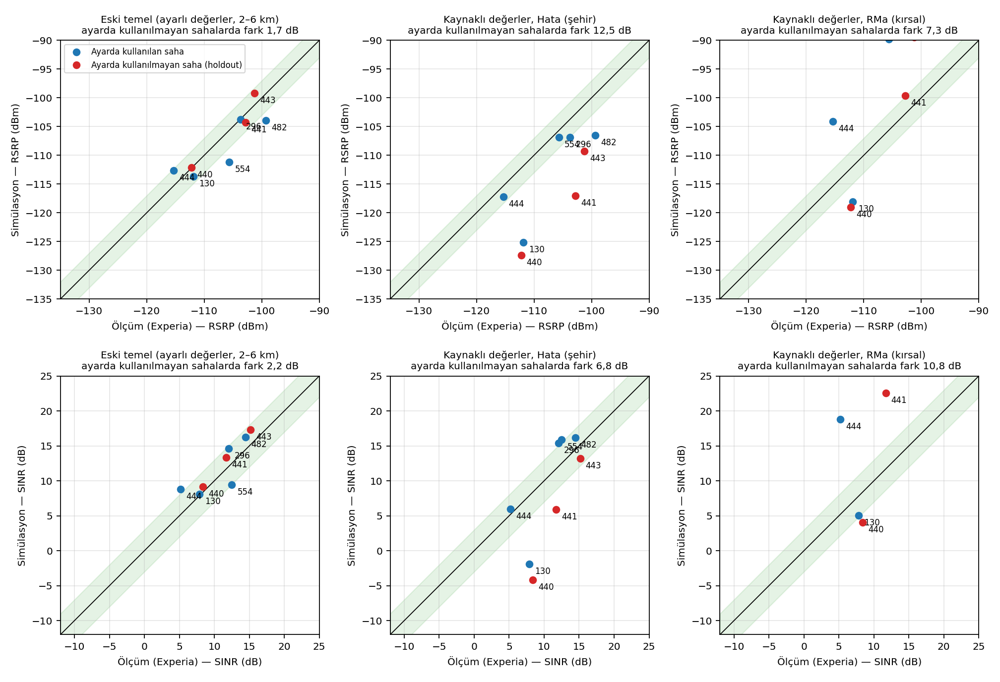

# Kırsal yol kaybı modeli (3GPP RMa) — 17 Kasım 2026

**Soru:** 20. deneyde şehir için yapılmış COST-231 Hata modelini kırsal Sındırgı'ya uyguladık ve sinyal
12–15 dB zayıf çıktı. Kırsal için yapılmış 3GPP RMa modeline geçersek ne olur?

**Durum: Eski sonuçla kontrol geçti, 3/3 koşu tamamlandı. Önceden yazılan karar kuralı geçmedi; S0 temel kalıyor.**

**Not:** RMa'yı 20. deneyin sonucunu gördükten sonra seçtik. Bunu açıkça belirtiyoruz.

## Kurulum

20. deneyin asıl senaryosuyla (R_TA) her şey aynı. Tek fark yol kaybı modeli: Hata yerine 3GPP TR 38.901
RMa kullanıldı. ns-3 `ThreeGppRmaPropagationLossModel`, varsayılan bina yüksekliği 5 m, yol genişliği 20 m.
Görüş hattının (LOS) olup olmadığı her bağlantı için RMa olasılığına göre bir kez belirlenip sabit tutuldu.
RMa'nın kendi gölgelemesi kapatıldı; 20. deneydeki 8 dB gölgeleme aynen kullanıldı. Kurallar koşudan önce
[prepare.py](prepare.py) içine yazıldı. RMa seçili değilken simülatör 16. deneyin kontrol koşusunu birebir
tekrar etti ([regression.json](regression.json)).

## Sonuç: ortalama düzeldi ama yakın ve uzak sahalar ters yönlere kaydı

| | Eski temel S0 | Kaynaklı + Hata (20. deney) | **Kaynaklı + RMa** |
|---|---:|---:|---:|
| Ayarda kullanılmayan sahalarda RSRP / SINR farkı (dB) | **1,7 / 2,2** | 12,5 / 6,8 | 7,3 / 10,8 |
| Ayarda kullanılan sahalarda RSRP / SINR farkı (dB) | 3,6 / 2,6 | 6,3 / 4,3 | 12,8 / 15,8 |
| Hücre RSRP medyanı (Experia −104,2 dBm) | −111,7 | −114,2 | **−101,5** |
| Hücre RSRP yayılımı, IQR (Experia 10,9 dB) | 5,3 | 13,3 | 27,0 |
| Hücre SINR medyanı (Experia 11,8 dB) | 8,6 | 8,6 | 20,6 |
| KPI CQI farkı | −1,1 | −2,9 | **0,0** |
| Bağlanan ölçüm kullanıcısı / 256 | 256 | 247–252 | 256 |

Saha bazında RSRP hatası (simülasyon − Experia, dB):

| Saha | 130 | 440 | 441 | 443 | 296 | 444 | 482 | 554 |
|---|---:|---:|---:|---:|---:|---:|---:|---:|
| Hata | −13,2 | −15,1 | −14,3 | −8,0 | −3,2 | −1,9 | −7,2 | −1,3 |
| RMa | −6,2 | −6,8 | +3,2 | +11,8 | +18,4 | +11,2 | +12,4 | +15,9 |

**Karar:** Ayarda kullanılmayan sahalarda RSRP farkı 7,3 dB, SINR farkı 10,8 dB. Kuralın sınırı 3 dB'ydi;
kural geçmedi, **S0 temel kalıyor.**

## Bu ne demek

1. **Ortalama doğru seviyeye geldi.** Hücre RSRP medyanı −101,5 dBm (Experia −104,2) ve CQI farkı sıfır.
   Yani kırsal model, sinyalin genel seviyesini Hata'dan çok daha iyi veriyor.
2. **Ama mesafeyle değişim gerçekte olduğundan çok daha dik.** Kullanıcıları kuleye yakın olan sahalarda
   (296, 554, 444, 482) sinyal 11–18 dB fazla güçlü, uzak sahalarda (130, 440) 6–7 dB fazla zayıf.
   Simülasyonda hücreler arası yayılım 27 dB, Experia'da 11 dB. Yakın kullanıcıların bir kısmı RMa'da kuleyi
   doğrudan görüyor (1 km'de olasılık yaklaşık %37) ve çok güçlü sinyal alıyor.
3. **Gerçek ağda yakın kullanıcıların sinyalini zayıflatan bir şey var.** Bu sonuç 15. deneydeki bulguyla
   aynı yönde. En olası açıklamalar: bina içi kayıp (yakın kullanıcıların çoğu kasabada ve büyük
   olasılıkla binaların içinde) ve gerçek anten eğimi ile yüksekliği. Hiçbir standart model bu iki bilgi
   olmadan Experia'daki dar yayılımı vermiyor.
4. **S0 bunu "etkin" değerlerle telafi ediyor.** S0'da 2–6 km yerleşim, 120° anten ve üs 3 birlikte
   seçildiği için saha ortalamaları tutuyor. Ancak S0'da da yayılım dar (5 dB) ve medyan 7 dB düşük.

## Öneri

- Temel senaryo S0 kalıyor. S0'nun değerleri, raporda "ölçümlere uydurulmuş etkin değerler" olarak
  açıklanmalı. Standart değerlerle yapılan iki deneme (Hata ve RMa) bunun nedenini gösteriyor.
- Gerçekçi modele ancak iki bilgi ile yaklaşılabilir: kullanıcıların ne kadarının bina içinde olduğu ve
  gerçek anten eğimi ve yüksekliği. Bu bilgiler Turkcell'den istenebilir. Elimizde olmadan bunları tahmin
  edip ayarlamak, yine "uyan değeri seçmek" olur.

## Sınırlar

- Ölçüm kullanıcılarının yaklaşık %21–22'si kuleden 5 km'den uzak. Bu, RMa'nın görüş hattı olmayan
  durum için geçerli olduğu aralığın dışında.
- Görüş hattı olasılığı rastgele bir kez belirlendi; arazi verisi yok.
- Yük katsayısı (1,47) eski radyo ayarına göre kalibre edilmişti; yeni ayarda ortalama PRB 0,18.
  Her örnekte 23–28 kullanıcı kısa koşuda veri alamadı.
- `simulation/results/smoke_RMa_TA` yalnızca derleme ve çalışma için yapılmış 1,2 saniyelik bir denemedir.

[Hazırlık](prepare.py) — [Koşu](study.py) — [Karşılaştırma](summarize.py) — [Sayılar](comparison.json)
