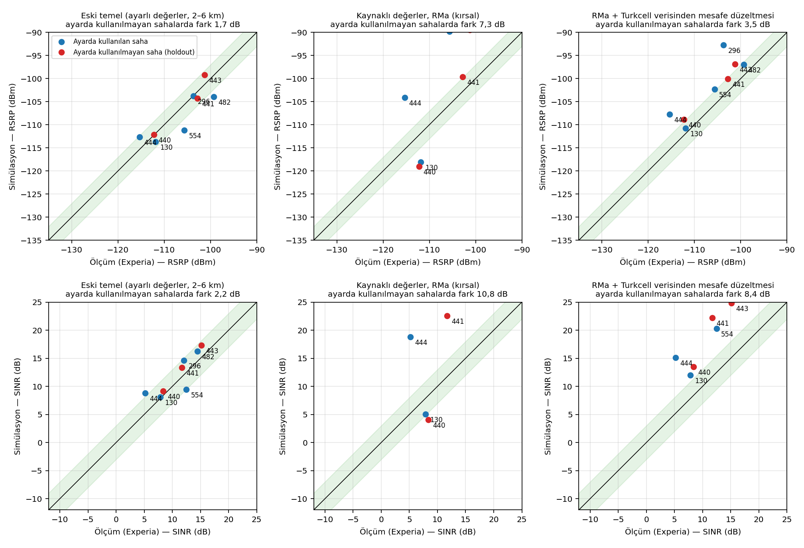

# Turkcell verisinden mesafe düzeltmesi — 17 Kasım 2026

**Soru:** Operatörden ek bilgi (bina içi oranı, gerçek anten eğimi ve yüksekliği) alamıyoruz. Bilmediğimiz bu
etkileri, Turkcell'in kendi ölçümlerinden türetilen bir mesafe düzeltmesiyle temsil edersek model ölçümlere
yaklaşır mı?

**Durum: Eski sonuçla kontrol geçti, 3/3 koşu tamamlandı. RSRP neredeyse hedefte, ama SINR çok yüksek.
Önceden yazılan karar kuralı geçmedi; S0 temel kalıyor.**

**Not:** Bu yöntem 20. ve 21. deneylerin sonuçları görüldükten sonra seçildi.

## Kurulum

Fiziksel model 21. deneyle aynı: kırsal 3GPP RMa, 1850 MHz, 49 dBm, 65° / 15 dBi anten, 6° eğim, 8 dB
gölgeleme, TA yerleşimi. Buna ek olarak her kullanıcıya, kuleye uzaklığına göre tek bir düzeltme eklendi.
Düzeltme o kullanıcının bütün bağlantılarına aynı miktarda uygulanıyor. Böylece komşu kulelerden gelen
girişimin geometrisi fiziksel kalıyor; değişen yalnızca kullanıcının genel sinyal seviyesi.

    düzeltme(d) = RSRP_RMa(d) − RSRP_Experia(d) = 110,8 − 32,3 · log10(d [m])     (d: 100 m – 15 km)

| Eğri | Veri | Sonuç |
|---|---|---|
| Gerçek ağ (Experia) | Bölgedeki **5.812 hücre**, 8 ana saha **hariç**; hücre RSRP ortalaması ile TA mesafesi | Mesafe 10 katına çıkınca **−10,6 dB** |
| RMa modeli | 21. deneyin 768 simüle kullanıcısı (yalnızca simülasyon çıktısı) | Mesafe 10 katına çıkınca **−42,9 dB** |

Düzeltme kuleye çok yakın kullanıcılarda 30–46 dB ek kayıp, 2 km civarında yaklaşık sıfır, uzak
kullanıcılarda 15–23 dB kazanç veriyor. Bu fiziksel bir yasa değil: bina içi kayıp, gerçek eğim ve
yükseklik, ağ planlaması gibi bilinmeyen etkilerin operatör verisinden türetilmiş toplu karşılığı.
Hesaplama koşudan önce yapıldı ve [plan.json](plan.json) içine yazıldı
([prepare.py](prepare.py)). Düzeltme kapalıyken simülatör 16. deneyin kontrol koşusunu birebir tekrar etti.

## Sonuç

| | Eski temel S0 | RMa (21. deney) | **RMa + düzeltme** |
|---|---:|---:|---:|
| Ayarda kullanılmayan sahalarda RSRP farkı (dB) | **1,7** | 7,3 | 3,5 |
| Ayarda kullanılmayan sahalarda SINR farkı (dB) | **2,2** | 10,8 | 8,4 |
| Ayarda kullanılan sahalarda RSRP / SINR farkı (dB) | 3,6 / 2,6 | 12,8 / 15,8 | 5,6 / 9,7 |
| Hücre RSRP medyanı (Experia −104,2 dBm) | −111,7 | −101,5 | **−104,2** |
| Hücre RSRP yayılımı, IQR (Experia 10,9 dB) | 5,3 | 27,0 | **11,5** |
| RSRP dağılım farkı (KS, küçük daha iyi) | 0,44 | 0,40 | **0,18** |
| Hücre SINR medyanı (Experia 11,8 dB) | **8,6** | 20,6 | 18,1 |
| KPI CQI farkı | −1,1 | 0,0 | +0,9 |
| Bağlanan ölçüm kullanıcısı / 256 | 256 | 256 | 256 |

Saha bazında hata (simülasyon − Experia, dB):

| Saha | 130 | 440 | 441 | 443 | 296 | 444 | 482 | 554 |
|---|---:|---:|---:|---:|---:|---:|---:|---:|
| RSRP | +1,2 | +3,4 | +2,7 | +4,4 | +11,0 | +7,6 | +2,4 | +3,4 |
| SINR | +4,2 | +5,1 | +10,5 | +9,7 | +15,5 | +9,9 | +11,1 | +7,8 |

**Karar:** Ayarda kullanılmayan sahalarda RSRP farkı 3,5 dB (sınır 3 dB), SINR farkı 8,4 dB. Kural geçmedi;
**S0 temel kalıyor.**

## Bu ne demek

1. **Sinyal gücü (RSRP) sorunu büyük ölçüde çözüldü.** Hücrelerin RSRP dağılımı Experia'ya şimdiye kadarki
   en yakın hâlinde: medyan tam aynı, yayılım 11,5 / 10,9 dB. 8 sahanın 6'sında hata 3,5 dB'nin altında.
   Bunu, test sahalarına hiç bakmadan, bölgenin geri kalanındaki Turkcell ölçümleriyle elde ettik.
2. **Şimdiki sorun sinyal kalitesi (SINR): model girişimi az buluyor.** Düzeltme her kullanıcının bütün
   bağlantılarına aynı uygulandığı için SINR'yi değiştirmiyor; SINR'nin yüksek kalmasının nedeni fiziksel
   modelde komşu kulelerden gelen girişimin az olması. Olası nedenler:
   - ns-3'teki cosine anten deseninin arka ve yan yönlerde zayıflamasının sınırsız olması. 3GPP deseninde
     zayıflama en fazla 25 dB'dir. Bu yüzden komşu sahaların arka ve yan yönlerinden gelen girişim eksik.
   - 6° eğimin uzak kulelerden gelen girişimi de kesmesi.
   - Modelde yalnızca 24 saha ve tek taşıyıcı olması.

   S0'daki 120° anten genişliği büyük olasılıkla bu eksik girişimi de telafi ediyordu.
3. **296 hâlâ zor saha.** Kullanıcıları kuleye çok yakın; düzeltmeden sonra da 11 dB güçlü kalıyor.

## Öneri

- Temel senaryo şimdilik S0. Ancak RSRP için bu yöntem S0'dan daha savunulabilir: yol kaybının mesafeyle
  değişimi, operatörün bölgedeki kendi ölçümlerinden geliyor.
- SINR için sıradaki mantıklı ve kaynaklı adım: cosine anten yerine **3GPP'nin kendi yatay anten desenini**
  (65°, en fazla 25 dB zayıflama; ns-3'te ParabolicAntennaModel) kullanmak. Bu bir ayar değil, 20. deneyde
  kullanmamız gereken standart desen. Bu deneyin sonucunu gördükten sonra seçildiği belirtilmeli.

## Sınırlar

- Düzeltme, hücre ortalamaları arasındaki ilişkiden türetildi (hücre ortalama RSRP – ortalama TA mesafesi).
  Bu ilişkiyi tek tek kullanıcılara uygulamak bir varsayım.
- Bölge eğrisi şehir hücrelerini de içeriyor; Sındırgı kırsal.
- Ölçüm kullanıcılarının yaklaşık %21–22'si kuleden 5 km'den uzak; bu, RMa'nın görüş hattı olmayan durum
  için geçerli olduğu aralığın dışında.
- Yük katsayısı (1,47) eski radyo ayarına göre kalibre edilmişti; yeni ayarda ortalama PRB 0,19.
- `simulation/results/smoke_DC_TA` yalnızca derleme ve çalışma için yapılmış 1,2 saniyelik bir denemedir.

[Hazırlık](prepare.py) — [Koşu](study.py) — [Karşılaştırma](summarize.py) — [Sayılar](comparison.json)
