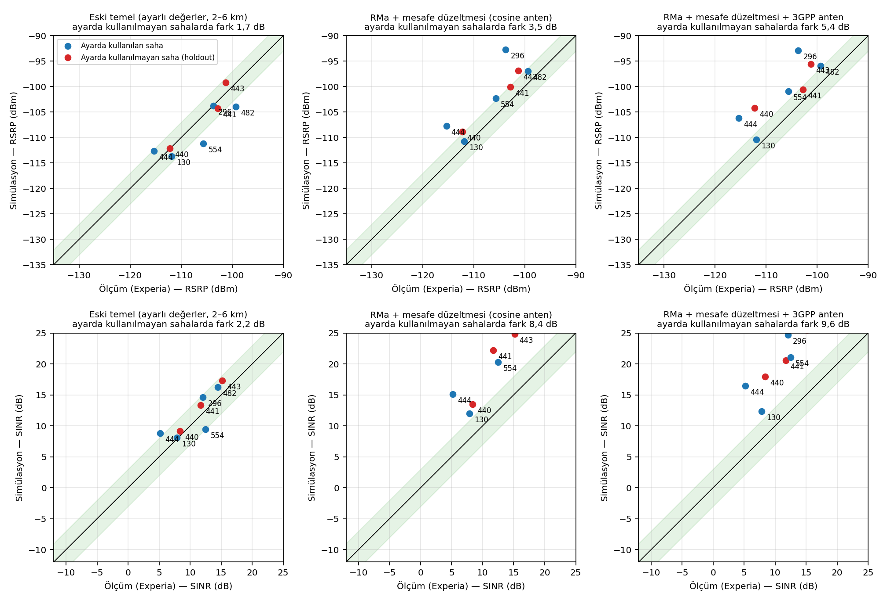

# 3GPP anten deseni — 18 Kasım 2026

**Soru:** 22. deneyde SINR yaklaşık 8 dB yüksekti; model komşu kulelerden gelen girişimi az buluyordu.
Nedeni, arka ve yan yönlerde zayıflaması sınırsız olan cosine anten mi? Standart 3GPP anten desenine
geçersek SINR düşer mi?

**Durum: Eski sonuçla kontrol geçti ([regression.json](regression.json)), 3/3 koşu tamamlandı. SINR düşmedi.
Önceden yazılan karar kuralı geçmedi; S0 temel kalıyor.**

**Not:** Bu adım 22. deneyin sonucunu gördükten sonra seçildi.

## Kurulum

22. deneyin DC_TA senaryosuyla her şey aynı; tek fark anten deseni. Cosine anten yerine 3GPP TR 36.814
Tablo A.2.1.1-2 makro deseni her bağlantıya (DL ve UL, yük kullanıcıları dahil) uygulandı:

    A_H = min(12·(φ/65°)², 25)   A_V = min(12·((θ − 6°)/10°)², 20)   A = min(A_H + A_V, 25) dB, tepe kazanç 15 dBi

65°, 10°, 6° ve 15 dBi, 20. deneyin kaynaklı değerleri. 25 dB ve 20 dB doğrudan rapordan alındı. Hiçbir
değer ayarlanmadı. Kurallar koşudan önce [prepare.py](prepare.py) içine yazıldı.

## Sonuç

| | Eski temel S0 | RMa + düzeltme, cosine (22) | **RMa + düzeltme, 3GPP anten** |
|---|---:|---:|---:|
| Ayarda kullanılmayan sahalarda RSRP farkı (dB) | **1,7** | 3,5 | 5,4 |
| Ayarda kullanılmayan sahalarda SINR farkı (dB) | **2,2** | 8,4 | 9,6 |
| Ayarda kullanılan sahalarda RSRP / SINR farkı (dB) | 3,6 / 2,6 | 5,6 / 9,7 | 6,4 / 9,8 |
| Hücre RSRP medyanı (Experia −104,2 dBm) | −111,7 | **−104,2** | −103,4 |
| Hücre RSRP yayılımı, IQR (Experia 10,9 dB) | 5,3 | 11,5 | **10,5** |
| Hücre SINR medyanı (Experia 11,8 dB) | **8,6** | 18,1 | 18,8 |
| Saha SINR sıralaması (Spearman) | — | 0,71 | **0,93** |
| Ortalama PRB kullanımı (KPI hedefi 0,233) | 0,254 | 0,185 | 0,198 |
| Bağlanan ölçüm kullanıcısı / 256 | 256 | 256 | 256 |

Saha bazında hata (simülasyon − Experia, dB):

| Saha | 130 | 440 | 441 | 443 | 296 | 444 | 482 | 554 |
|---|---:|---:|---:|---:|---:|---:|---:|---:|
| RSRP | +1,5 | +8,1 | +2,2 | +5,7 | +10,8 | +9,2 | +3,4 | +4,7 |
| SINR | +4,5 | +9,6 | +8,9 | +10,3 | +12,6 | +11,3 | +11,5 | +8,6 |

**Karar:** Ayarda kullanılmayan sahalarda RSRP farkı 5,4 dB, SINR farkı 9,6 dB. Kural geçmedi;
**S0 temel kalıyor.**

## Bu ne demek

1. **Anten deseni sorunun nedeni değilmiş.** Arka ve yan yönlere 25 dB tavan koymak SINR'yi düşürmedi.
   Komşu sektörlerin arkasından gelen sinyal, girişimin küçük bir kısmıymış.
2. **Bir iyi haber var:** Sahaların SINR sıralaması Experia ile neredeyse aynı (Spearman 0,93). Yani hangi
   sahanın iyi, hangisinin kötü olduğunu model doğru veriyor; sorun bütün sahalarda aynı yönde, yaklaşık
   9–10 dB'lik bir kayma.
3. **Asıl şüpheli artık yük.** Yük katsayısı (1,47) eski radyo ayarına göre kalibre edilmişti. Yeni
   ayarda sinyal daha iyi olduğu için kullanıcılar aynı trafiği daha az kaynakla taşıyor: PRB kullanımı
   0,19–0,20, KPI'daki 0,233'ün altında. Komşu hücreler daha az gönderince girişim de azalıyor. Ayrıca
   modelde yalnızca 24 saha ve tek taşıyıcı var; gerçek ağda daha fazla girişim kaynağı bulunuyor.
4. RSRP 22. deneye göre biraz kötüleşti (3,5 → 5,4 dB). Nedeni, 3GPP deseninin ana yön dışında cosine
   desenden farklı zayıflatması; 22'deki mesafe düzeltmesi cosine desenle elde edilen RMa sonucuna göre
   hesaplanmıştı.

## Öneri

- Temel senaryo S0 kalıyor.
- SINR için sıradaki adım: yük katsayısını, yeni radyo ayarında KPI'daki PRB kullanımını (0,233) verecek
  şekilde yeniden kalibre etmek. Bu, SINR'ye uydurmak değil; ölçülen yüke uymak. Ancak 0,19'dan 0,23'e
  çıkmak tek başına 9 dB'lik farkı kapatmaya yetmeyebilir.
- Bu sonuçla birlikte, S0'nun değerlerini raporda "ölçümlere uydurulmuş etkin değerler" olarak sunmak ve
  kaynaklı denemeleri (20–23) bunun gerekçesi olarak göstermek de makul bir seçenek.

## Sınırlar

- Desen, anten elemanı izotropik 15 dBi kabul edilip her bağlantıya kayıp olarak eklendi. Bu, 3GPP'nin
  sistem simülasyonlarındaki kullanımıyla aynı; gerçek antenin ölçülmüş deseni değil.
- Mesafe düzeltmesi 22. deneyden aynen alındı, yeniden hesaplanmadı.
- Ölçüm kullanıcılarının yaklaşık %21–22'si kuleden 5 km'den uzak; RMa'nın geçerli aralığının dışında.

[Hazırlık](prepare.py) — [Koşu](study.py) — [Karşılaştırma](summarize.py) — [Sayılar](comparison.json)
