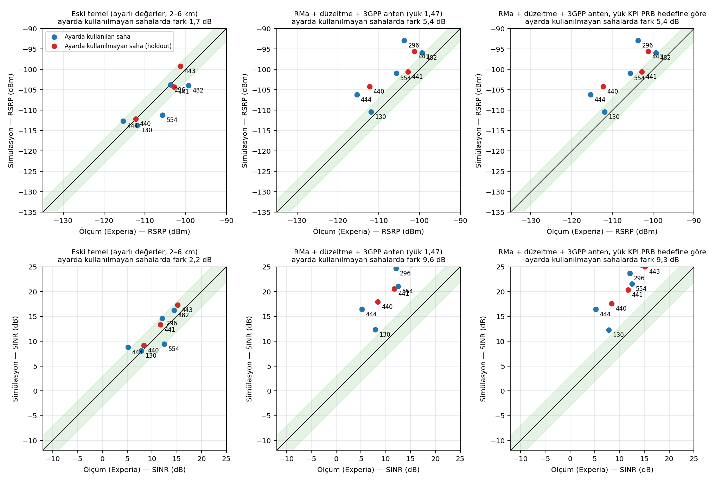

# Yükün yeniden kalibrasyonu — 19 Kasım 2026

**Soru:** 23. deneyde SINR yaklaşık 9–10 dB yüksekti ve PRB kullanımı 0,198'di; KPI'daki günlük ortalama
0,233. Yük katsayısını yeni radyo ayarına göre KPI yüküne eşitlersek girişim artar ve SINR düşer mi?

**Durum: Eski sonuçla kontrol geçti ([regression.json](regression.json)), 3/3 koşu tamamlandı. SINR neredeyse
değişmedi. Önceden yazılan karar kuralı geçmedi; S0 temel kalıyor.**

**Not:** Bu adım 23. deneyin sonucunu gördükten sonra seçildi.

## Kurulum

23. deneyle her şey aynı; tek fark yük kullanıcılarının paket aralığı. Kural koşudan önce
[calibrate.py](calibrate.py) içine yazıldı ve 14. deneydeki S0 kalibrasyonuyla aynı:

- Tek hedef KPI ortalama PRB'si (0,233). SINR, RSRP, CQI kalibrasyonda kullanılmadı.
- Yalnızca 701 örneği. İlk adım orantılı: 1,47 × 0,197 / 0,233 = **1,243**.
- Bu katsayıyla 701'de PRB **0,231** çıktı (±%5 içinde), katsayı ikinci tura gerek kalmadan donduruldu
  ([calibration/calibration.json](calibration/calibration.json)).

## Sonuç

| | Eski temel S0 | 3GPP anten, yük 1,47 (23) | **3GPP anten, yük KPI'ya göre** |
|---|---:|---:|---:|
| Ortalama PRB (KPI 0,233) | 0,254 | 0,198 | **0,232** |
| Ayarda kullanılmayan sahalarda RSRP farkı (dB) | **1,7** | 5,4 | 5,4 |
| Ayarda kullanılmayan sahalarda SINR farkı (dB) | **2,2** | 9,6 | 9,3 |
| Ayarda kullanılan sahalarda SINR farkı (dB) | **2,6** | 9,8 | 9,5 |
| Hücre SINR medyanı (Experia 11,8 dB) | **8,6** | 18,8 | 18,5 |
| Saha SINR sıralaması (Spearman) | — | 0,93 | 0,93 |
| Bağlanan ölçüm kullanıcısı / 256 | 256 | 256 | 256 |

Saha bazında SINR hatası (simülasyon − Experia, dB):

| Saha | 130 | 440 | 441 | 443 | 296 | 444 | 482 | 554 |
|---|---:|---:|---:|---:|---:|---:|---:|---:|
| SINR | +4,4 | +9,2 | +8,7 | +9,9 | +11,6 | +11,2 | +10,9 | +9,0 |

**Karar:** Ayarda kullanılmayan sahalarda RSRP farkı 5,4 dB, SINR farkı 9,3 dB. Kural geçmedi;
**S0 temel kalıyor.**

## Bu ne demek

1. **Yük de sorunun nedeni değil.** PRB'yi KPI'ya eşitlemek (%17 daha fazla yük) SINR'yi yalnızca
   0,3 dB düşürdü. RSRP hiç değişmedi.
2. **Anten (23) ve yük (24) elendi.** Geriye kalan en güçlü aday, SINR'nin nasıl tanımlandığı:
   - Simülasyondaki SINR, veri kanalındaki SINR. Komşu hücre ancak o anda veri gönderiyorsa girişim
     yapıyor; %23 yükte komşuların çoğu çoğu zaman sessiz.
   - Gerçek ağda telefonun bildirdiği SINR büyük olasılıkla referans sinyalleri üzerinden ölçülüyor. Bu
     sinyalleri bütün komşu hücreler yükten bağımsız olarak her zaman gönderiyor. Yani gerçek SINR,
     "komşular hep açık" durumuna daha yakın.
   - Bu, S0'nun SINR'yi neden tutturduğunu da açıklayabilir: S0'nun geniş anteni ve düşük sinyali bu
     eksik girişimi dolaylı olarak telafi ediyordu.
3. Ayrıca modelde yalnızca 24 saha ve tek taşıyıcı var; gerçek ağda daha uzak sahalardan da girişim geliyor.

## Öneri

- Temel senaryo S0 kalıyor.
- Sıradaki mantıklı kontrol: simülasyonun zaten ürettiği "kontrol kanalı SINR'ı" (komşuların hep
  gönderdiği varsayımıyla hesaplanan SINR) ile Experia'yı karşılaştırmak. Bu yeni bir koşu gerektirmiyor.
  Ancak bu ölçütü sonucu gördükten sonra seçmiş oluruz; raporda açıkça belirtilmeli ve S0 için de aynı
  ölçütle karşılaştırma yapılmalı.
- Experia'daki SINR'nin tam tanımı (RS-SINR mi, PDSCH SINR mı) operatörden ya da veri sözlüğünden
  doğrulanabilirse bu karar kaynaklı hale gelir.

## Ek tanı: "komşular hep açık" SINR'ı (yeni koşu yok, sonuç görüldükten sonra yapıldı)

Aynı üç koşunun `sinr_components.csv` dosyalarından, kontrol kanalı SINR'ı (bütün komşular her an gönderiyor
varsayımı) aynı saha ortalaması yöntemiyle hesaplandı. Veri kanalı SINR'ı bu yöntemle resmi sonucu birebir
verdi (9,26 dB), yani hesap tutarlı.

| SINR tanımı | Ayarda kullanılmayan sahalarda fark | Ayarda kullanılan sahalarda fark | İşaret |
|---|---:|---:|---|
| Veri kanalı (resmi ölçüt) | 9,3 dB | 9,5 dB | 8 sahanın 8'inde yüksek |
| Kontrol kanalı, komşular hep açık | 5,9 dB | 4,4 dB | 8 sahanın 7'sinde düşük |

Saha bazında kontrol kanalı SINR hatası (dB): 130 −4,9, 440 −2,6, 441 −7,4, 443 −7,7, 296 −4,2, 444 +3,2,
482 −5,8, 554 −3,9.

**Anlamı:** Gerçek ağın SINR'ı iki uç durumun arasında kalıyor. "Komşular hiç göndermiyor"a yakın veri
kanalı 9 dB yüksek, "komşular hep tam güçte gönderiyor" olan kontrol kanalı ise 4–6 dB düşük. Bu,
SINR farkının büyük kısmının ölçüm tanımından ve girişimin nasıl modellendiğinden geldiğini gösteriyor;
yol kaybı ya da anten değerleri ayarlanarak kapatılmamalı. Experia'nın SINR tanımı öğrenilmeden iki
uçtan birini seçmek yine "uyanı seçmek" olur.

## Sınırlar

- Katsayı tek örnekte bulundu (701); diğer iki örnekte PRB 0,232 civarında kaldı.
- Mesafe düzeltmesi 22. deneyden aynen alındı.

[Kalibrasyon](calibrate.py) — [Hazırlık](prepare.py) — [Koşu](study.py) — [Karşılaştırma](summarize.py) — [Sayılar](comparison.json)
