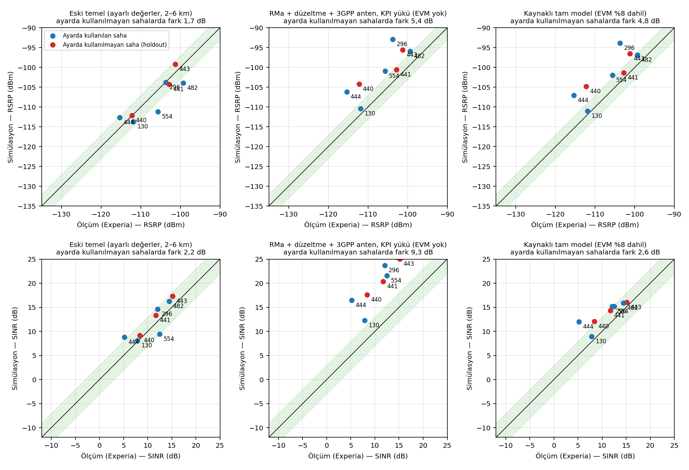

# Kaynaklı tam model (EVM dahil) — 19 Kasım 2026

**Soru:** 20–25. deneylerin bütün kaynaklı parçaları bir arada, EVM simülatörün içinde olursa model ölçümlere
ne kadar yaklaşır?

**Durum: Eski sonuçla kontrol geçti ([regression.json](regression.json)), 3/3 koşu tamamlandı. SINR kuralı
geçti (2,6 dB), RSRP geçmedi (4,8 dB). Karar kuralı geçmedi; S0 temel kalıyor.**

**Not:** Bu tasarım 20–25. deneylerin sonuçları görüldükten sonra yapıldı.

## Kurulum

Her parçanın kaynağı var; ölçüm sahalarının sonucuna göre ayarlanan değer yok:

| Parça | Değer | Kaynak |
|---|---|---|
| Yol kaybı | 3GPP RMa (kırsal) | TR 38.901 |
| Frekans, güç, anten | 1850 MHz B3, 49 dBm, 65° / 15 dBi, 6° eğim | 20. deney (CellMapper, veri sayfaları) |
| Anten deseni | 25 dB arka/yan tavanı, 20 dB dikey tavan | TR 36.814 |
| **Verici kalitesi (EVM)** | **%8, simülatörün içinde** | **TS 36.104 Tablo 6.5.2-1** |
| Mesafe düzeltmesi | 113,2 − 32,7·log10(d) dB | Bölgedeki 5.812 Turkcell hücresi (8 ana saha hariç), 22. deney yöntemi, 3GPP antenle yeniden hesaplandı ([correction.py](correction.py)) |
| Yük | Katsayı 1,243 | KPI PRB 0,233, yalnızca 701'de (PRB 0,240; ±%5 içinde, ilk turda donduruldu) |

**EVM nasıl eklendi:** ns-3 kütüphanesi dışarıdan fonksiyon değiştirmeye izin vermediği için LTE
kütüphanesinin özel bir kopyası deney klasöründe derlendi ([build_private_lte.py](simulation/build_private_lte.py)).
Kurulu ns-3'e dokunulmadı. İki yerde aynı formül uygulanıyor: SINR_etkin = 1 / (1/SINR + 0,08²). Birincisi
veri çözmede kullanılan SINR, ikincisi telefonun bildirdiği ve CQI'yi belirleyen SINR. Girişim ve RSRQ
ölçümleri değişmiyor. EVM kapalıyken kontrol koşusu 16. deneyi birebir tekrar etti. EVM açık/kapalı deneme
koşusunda SINR en fazla 21,9 dB'ye çıktı ve her örnek formülle aynıydı (`simulation/results/smoke_evm0`,
`smoke_evm8`, 1,2 saniyelik denemeler).

## Sonuç

| | Eski temel S0 | 24. deney (EVM yok) | **Kaynaklı tam model** |
|---|---:|---:|---:|
| Ayarda kullanılmayan sahalarda RSRP farkı (dB) | **1,7** | 5,4 | 4,8 |
| Ayarda kullanılmayan sahalarda SINR farkı (dB) | **2,2** | 9,3 | **2,6** |
| Ayarda kullanılan sahalarda RSRP / SINR farkı (dB) | 3,6 / 2,6 | 6,4 / 9,5 | 5,6 / 3,3 |
| Hücre RSRP medyanı (Experia −104,2 dBm) | −111,7 | −103,4 | **−104,2** |
| Hücre RSRP yayılımı, IQR (Experia 10,9 dB) | 5,3 | 10,5 | **9,9** |
| RSRP dağılım farkı (KS, küçük daha iyi) | 0,44 | 0,24 | **0,17** |
| Hücre SINR medyanı (Experia 11,8 dB) | **8,6** | 18,5 | 16,2 |
| Hücre SINR yayılımı, IQR (Experia 6,9 dB) | 3,1 | 11,1 | **7,3** |
| Saha SINR sıralaması (Spearman) | 0,90 | 0,93 | **0,95** |
| KPI CQI farkı / mutlak fark | −1,1 / 1,3 | +1,0 / 1,2 | **+0,5 / 0,9** |
| Ortalama PRB (KPI 0,233) | 0,254 | 0,232 | 0,244 |
| Bağlanan ölçüm kullanıcısı / 256 | 256 | 256 | 256 |

Saha bazında hata (simülasyon − Experia, dB):

| Saha | 130 | 440 | 441 | 443 | 296 | 444 | 482 | 554 |
|---|---:|---:|---:|---:|---:|---:|---:|---:|
| RSRP | +0,8 | **+7,4** | +1,4 | +4,8 | **+9,9** | **+8,3** | +2,5 | +3,7 |
| SINR | +1,1 | +3,7 | +2,6 | +0,9 | +3,1 | +6,8 | +1,4 | +2,7 |

**Karar:** Ayarda kullanılmayan sahalarda SINR farkı 2,6 dB (sınır 3), RSRP farkı 4,8 dB (sınır 3). Kural
geçmedi; **S0 temel kalıyor.**

## Bu ne demek

1. **SINR sorunu çözüldü.** EVM simülatörün içine girince SINR farkı 9,3 dB'den 2,6 dB'ye indi. Yayılım
   Experia ile neredeyse aynı (7,3 / 6,9 dB), saha sıralaması 0,95, CQI farkı şimdiye kadarki en küçük
   (mutlak 0,9). Bunu hiçbir değeri ayarlamadan, yalnızca standartlardaki değerlerle elde ettik.
2. **RSRP dağılımı da Experia'ya en yakın hâlinde:** medyan aynı, yayılım ve KS en iyi değerler.
3. **Kalan sorun üç sahaya özel:** 296, 440 ve 444'te sinyal 7–10 dB güçlü, diğer beş sahada fark 0,8–4,8 dB.
   Mesafe düzeltmesi bütün bölge için ortak olduğundan sahaya özel farkları düzeltemiyor. Olası nedenler:
   - Anten yönleri (azimutlar) bilinmiyor; rastgele üç çekiliş kullanılıyor. Kullanıcı antenin tam
     önündeyse sinyal güçlü, yanındaysa zayıf çıkıyor. 22. deneyde (cosine anten) 440'ın hatası +3,4 dB'ydi;
     anten deseni değişince en çok bu saha etkilendi.
   - 296'nın kullanıcıları kuleye çok yakın (bütün deneylerde zor saha).
   - Sahaya özel anten yüksekliği ve eğimi (hepsi 30 m ve 6° kabul edildi).

## Öneri

- Temel senaryo resmi olarak S0 kalıyor. Ama kaynaklı model artık SINR'de geçiyor ve dağılım
  ölçütlerinin hepsinde S0'dan iyi. RSRP'de yalnızca üç sahada sorun var.
- Sıradaki en mantıklı adım sahaya özel bilgi: gerçek anten azimutları. 296, 440 ve 444 için CellMapper'da
  sektör yönü görünüyorsa elle bakılabilir, ya da operatörden istenebilir. Bu, ayar değil gerçek bilgi olur.

## Ek: azimutun etkisi (sonuçtan sonra bakıldı, yeni koşu yok)

Gerçek azimut bulunamıyor: 17 Kasım'daki CellMapper taramasında 8 sahanın hiçbirinde veri yoktu (en yakın
Turkcell LTE kulesi 20–33 km uzakta). Bu yüzden üç rastgele azimut çekilişinde sahaların RSRP hatasına baktık
(simülasyon − Experia, dB):

| Saha | 130 | **440** | 441 | 443 | **296** | **444** | 482 | 554 |
|---|---:|---:|---:|---:|---:|---:|---:|---:|
| Çekiliş 701 (azimut 42) | +1,9 | **+0,1** | +3,7 | +4,7 | +10,2 | +10,0 | +0,8 | +0,2 |
| Çekiliş 702 (azimut 7) | −4,3 | **+9,5** | +1,8 | +0,9 | +8,7 | +7,5 | +3,7 | +2,6 |
| Çekiliş 703 (azimut 99) | +5,0 | **+12,6** | −1,2 | +8,7 | +10,7 | +7,5 | +2,9 | +8,4 |

- **440'ın hatası tamamen azimuta bağlı:** bir çekilişte 0,1 dB, diğerlerinde 9,5 ve 12,6 dB. Azimut
  bilinseydi bu saha büyük olasılıkla tutardı. Ayarda kullanılmayan sahaların RSRP farkı çekilişe göre 2,8 /
  4,1 / 7,5 dB; yani kuralın RSRP kısmı büyük ölçüde bilinmeyen azimuta takılıyor. (Bir çekilişi sonuca bakarak
  seçmek uydurma olur; ortalama kullanılmaya devam ediyor.)
- **296 ve 444 azimuttan bağımsız olarak 7,5–10,7 dB güçlü.** Bu iki sahada sistematik bir fark var. 296'nın
  kullanıcıları kuleye çok yakın; 444'ün hücreleri bizim gruplamamızda kısa menzilli katmanda (L3). İkisi için
  de sahaya özel bilgi (anten yüksekliği, eğim, güç ya da bina içi oranı) olmadan düzeltme yapılamaz.

## Sınırlar

- EVM sınırı en kötü durum şartı. Gerçek vericiler genelde daha iyidir, ama telefonun kendi alıcısı da bir
  tavan ekler. Experia'daki ~20 dB'lik tavanla uyumlu.
- UL'de de aynı %8 uygulandı (UE için TS 36.101'deki 64QAM sınırı da %8).
- Ölçüm kullanıcılarının %21–22'si kuleden 5 km'den uzak; RMa'nın geçerli aralığının dışında.

[Düzeltme](correction.py) — [Kalibrasyon](calibrate.py) — [Hazırlık](prepare.py) — [Koşu](study.py) —
[Karşılaştırma](summarize.py) — [Sayılar](comparison.json) — [Özel kütüphane](simulation/build_private_lte.py)
