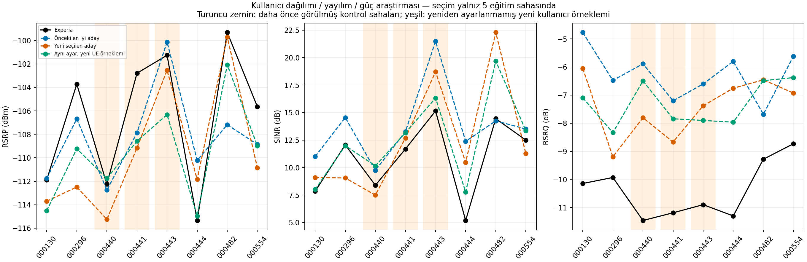
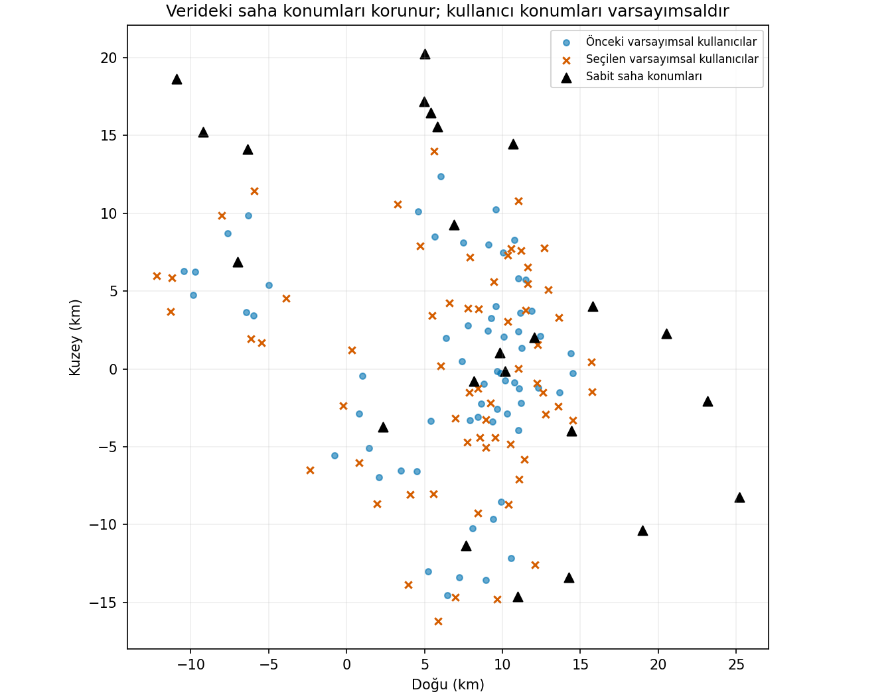

# Kullanıcı, yayılım ve güç araştırması — sonuçlar

**Seçilen aday: candidate_01** — 2–6 km kümeler, 120° anten, yayılım üssü 3.0, sektör gücü 49 dBm. Mixed ve düşük UDP yükü kullanıldı.

Önceki adayın ortak eğitim puanı 3.492, yeni adayın 3.484. Puanlar birbirine çok yakındır; eğitim sıralaması güçlü bir üstünlük kanıtı değildir. Kontrol ve yeni kullanıcı örneklemi sonuçları ayrı değerlendirilmelidir.

135 analitik ön eleme hesabından sonra **5 gerçek ns-3 seçim koşusu** ve **3 takip koşusu** tamamlandı. Analitik SINR S/N yaklaşımıdır; native sonuç veya gerçek ağ doğrulaması olarak sunulmaz.

## Veriden gelenler korundu

Saha koordinatları ve kimlikleri, hücre eşlemeleri ve Experia hedefleri değiştirilmedi. Değişenler bilinmeyen kullanıcı dağılımı, anten genişliği, log-distance üssü ve yayın gücü hipotezleridir. Üç ek saha konumunun kaynak belirsizliği devam ediyor.

## Gerçek ns-3 adayları

| Aday | Yerleşim | Anten / üs / dBm | Eğitim RSRP / SINR / RSRQ MAE | Puan | Kontrol RSRP / SINR / RSRQ MAE | Geçerli eğitim/kontrol |
|---|---|---|---|---:|---|---|
| candidate_01 | 2–6 km kümeler | 120° / 3.0 / 49 | 3.93 / 3.72 / 2.80 | 3.484 | 3.55 / 1.82 / 3.23 | 5/5 — 3/3 |
| baseline | 1–4 km kümeler | 120° / 3.0 / 46 | 3.86 / 2.81 / 3.81 | 3.492 | 2.24 / 3.09 / 4.62 | 5/5 — 3/3 |
| candidate_04 | 2–6 km kümeler | 65° / 2.7 / 43 | 2.75 / 5.00 / 3.46 | 3.734 | 1.18 / 3.46 / 3.98 | 5/5 — 3/3 |
| candidate_02 | 1–4 km kümeler | 120° / 3.0 / 43 | 5.60 / 1.92 / 3.68 | 3.735 | 4.48 / 1.98 / 4.51 | 5/5 — 3/3 |
| candidate_03 | bölge içinde uniform | 120° / 3.0 / 49 | 4.75 / 4.91 / 2.75 | 4.136 | 9.95 / 10.03 / 4.94 | 5/5 — 3/3 |

Seçim kuralı: üç eğitim MAE ortalaması + eksik eğitim sahası cezası. Kontrol değerleri seçime katılmadı. Bu sahalar daha önce görüldüğü için kör doğrulama değildir. Tek bir metriğin iyileşip diğerinin kötüleşmesi tabloda açıkça gösterilir.

Seçilen adayda sekiz saha arasındaki en büyük mutlak hatalar: RSRP 8.77, SINR 7.84, RSRQ 4.54 dB. Ortalamaların yakınlığı her sahanın yakın olduğu anlamına gelmez; saha tablosu ve grafikler birlikte sunulmalıdır.

## Takip kontrolleri

Yeni kullanıcı örnekleminde eğitim hataları **2.92 / 1.78 / 2.62 dB**, kontrol hataları **3.78 / 1.47 / 3.77 dB**; geçerli saha sayısı 5/5 ve 3/3. Yeni örnekleme göre yeniden ayar yapılmadı.

| Komşu çevresini genişletme | %95 mutlak RSRP farkı | %95 mutlak SINR farkı | RSRQ farkı (tanısal) | Aynı hizmet sektörü | Eşikler |
|---|---:|---:|---:|---:|---|
| 24 → 32 toplam saha | 0.000 dB | 0.243 dB | 0.139 dB | %100.0 | geçti |
| 32 → 48 toplam saha | 0.000 dB | 0.364 dB | 0.156 dB | %100.0 | geçti |

İki ardışık genişletme: **geçti**. Eşikler RSRP/SINR %95 farkı ≤1 dB ve aynı hizmet sektörü ≥%95. RSRQ farkı ayrıca tanısal olarak verilir, önceden yazılan geçme kuralına sonradan eklenmez. Mixed örnekleme ve zamanlayıcı etkileri de bu farklara dahildir.

## Nasıl sunulmalı?

Bu sonuç, denenmiş hipotezler içinde eğitimden seçilen bir adaydır. Gerçek anten/yayılım/yük ayarlarının bulunduğunu göstermez. Yeni UE örneklemindeki değişim, örneklem belirsizliğini görünür kılar. RSRQ farkının sürüp sürmediği ayrıca okunmalıdır. Eksik saha veya geçmeyen takip kontrolü varsa sonuçla birlikte sunulmalıdır.

Seçilen senaryo `selected_scenario/` altında ayrı saklandı. Özgün başlangıç senaryosu değişmedi.

[Kalan RSRQ farkı için ölçüm tanımı araştırması](RSRQ_TANIM_NOTU.md). Bu not bir sayısal düzeltme uygulamaz; standart ve model tanımlarını ayırır.





## Dosyalar ve tekrar üretim

`proxy_screen.csv` yalnız analitik ön elemeyi; `summary.csv`, `site_comparison.csv`, `ue_comparison.csv` native koşuları; `checks.json` doğrulamaları içerir. `training_selection.json` kontrol ve takip sonuçları eklenmeden sabitlenen seçimdir.

Proje kökünde PowerShell:

```powershell
.\.venv\Scripts\python.exe experiments/placement_propagation_2026-11-10/prepare.py
wsl --distribution Ubuntu-22.04 --exec python3 experiments/placement_propagation_2026-11-10/run_campaign.py
.\.venv\Scripts\python.exe experiments/placement_propagation_2026-11-10/report.py
```
