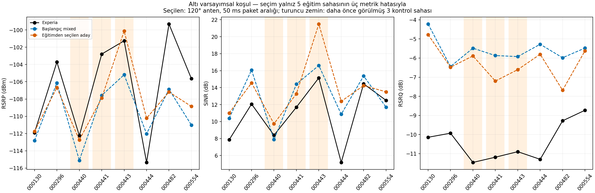
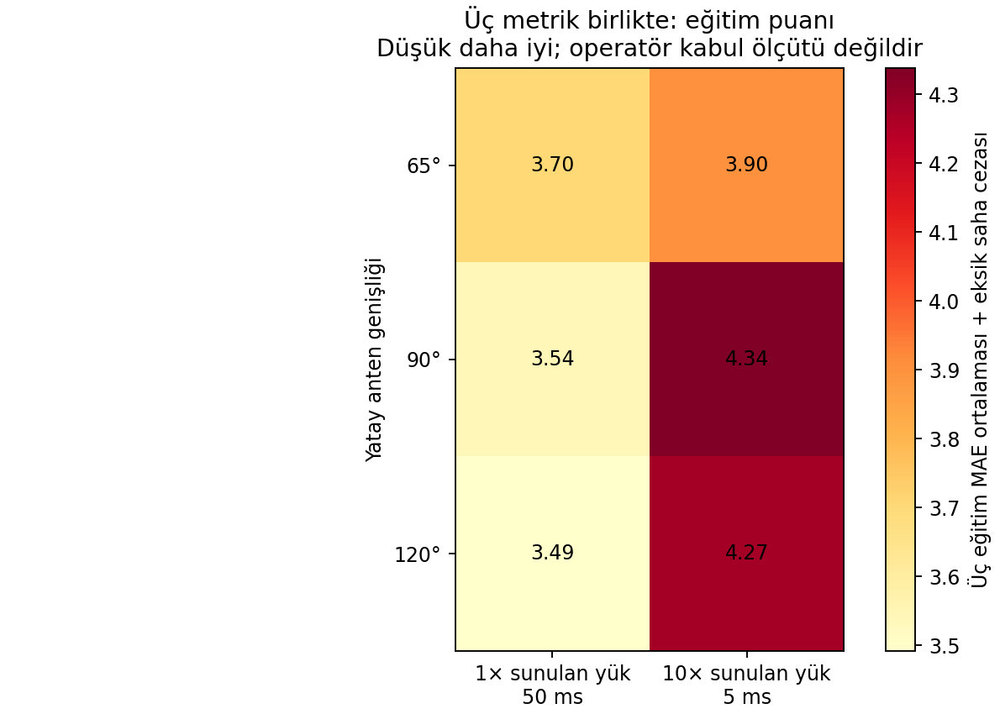

# RSRP, SINR ve RSRQ için altı koşulluk keşif taraması

Amaç eldeki ölçüm özetlerine daha yakın, açık varsayımlı bir başlangıç adayı bulmak. Gerçek anten/yük yapılandırmasını çıkarmak veya tam ağı yeniden kurmak değil.

**Sonuç:** Eğitimden seçilen aday 120° / 50 ms. Ortak eğitim puanı 3.702'den 3.492'e (yaklaşık %5.7 azalma) indi. Bu mütevazı bir toplam iyileşme; bütün metrikler aynı anda düzelmedi. Kontrol sahalarında RSRP/RSRQ hataları azaldı, SINR hatası büyüdü. Bu nedenle 65°, 90° ve 120° düşük yük adayları birer tradeoff olarak korunmalıdır.

## Ne değişti?

- Anten yatay genişliği: 65°, 90°, 120°. Tepe kazancı 15 dBi ve sektör başına güç 46 dBm korundu.
- UDP paket aralığı: 50 ms ve 5 ms; kullanıcı başına sunulan yük 0,08192 ve 0,8192 Mbps. 64 kullanıcı toplamı 5,24288 ve 52,4288 Mbps. Bunlar gerçek talep tahmini değildir.
- Aynı 24 saha, 72 sektör, 64 kullanıcı konumu, yönler, yayılım ve mixed yöntemi kullanıldı. Genişlik değişince kullanıcıların bağlandığı saha/sektör değişebilir.
- Her koşu 4 s; ilk 1 s dışarıda. Bu kısa pilot bir kapasite, gerçek hizmet veya deprem yükü doğrulaması değildir.

## Seçim kuralı

Önceden yazılan kural: beş eğitim sahasında RSRP, SINR, RSRQ MAE değerlerinin eşit ağırlıklı ortalaması + eksik eğitim sahası başına 10 dB ceza. Eşit ağırlık keşif amaçlıdır; operatör kabul kriteri değildir. Üç kontrol sahası sıralamaya alınmadı; daha önce görüldüklerinden kör doğrulama değildir. Bütün sonuçlar aşağıda korunur.

| Anten / aralık | Eğitim RSRP | Eğitim SINR | Eğitim RSRQ | Eğitim puanı | Geçerli eğitim/kontrol | Bağlanan / DL alan |
|---|---:|---:|---:|---:|---:|---:|
| 120° / 50 ms **seçilen** | 3.86 | 2.81 | 3.81 | 3.49 | 5/5 — 3/3 | 64/64 — 64/64 |
| 90° / 50 ms | 3.85 | 2.61 | 4.15 | 3.54 | 5/5 — 3/3 | 64/64 — 64/64 |
| 65° / 50 ms | 3.92 | 2.79 | 4.40 | 3.70 | 5/5 — 3/3 | 64/64 — 64/64 |
| 65° / 5 ms | 3.92 | 3.39 | 4.40 | 3.90 | 5/5 — 3/3 | 64/64 — 64/64 |
| 120° / 5 ms | 3.86 | 5.16 | 3.81 | 4.27 | 5/5 — 3/3 | 64/64 — 64/64 |
| 90° / 5 ms | 3.85 | 5.01 | 4.15 | 4.34 | 5/5 — 3/3 | 64/64 — 64/64 |

## Başlangıç mixed ve seçilen aday: kontrol sahaları

| Metrik MAE (dB) | 65° / 50 ms başlangıç | Eğitimden seçilen aday |
|---|---:|---:|
| RSRP | 3.86 | 2.24 |
| SINR | 1.56 | 3.09 |
| RSRQ | 5.42 | 4.62 |

Seçilen aday: **120° ve 50 ms**. Bu, yalnız denenmiş altı koşulun eğitim puanına göre seçimidir; bütün parametre uzayının optimumu değildir.

## Yorumlama sınırları

- Her metriği ayrı okuyun. Eğitim puanındaki düşüşün kontrol sahalarına aynı biçimde taşınması garanti değildir.
- Eksik sahalar ve hizmet alan kullanıcıların değişmesi ortalamaları etkileyebilir. Saha ve kullanıcı tabloları bu nedenle ayrıca saklandı.
- Daha geniş anten, tepe kazancı sabitken farklı yönlere giden gücü artırır. Bu gerçek antenin bulunduğunu göstermez; bir senaryo hipotezidir.
- Mixed SINR veri yüküne ve ölçüm güncellemesine duyarlıdır. Sunulan sentetik yükü gerçek KPI yükü gibi yorumlamayın. 2025 KPI ile 2026 radyo dönemi eşzamanlı değildir.
- 553/554/555 konumlarının kaynağı ve Experia ölçüm tanımları hâlâ açık. Seçilen adayda komşu yakınsaması ve başka kullanıcı/azimut örnekleri yeniden sınanmadı.
- Ana proje ve sabit başlangıç senaryosu değiştirilmedi. Bu ayrı bir aday taramasıdır.

## Görseller





## Dosyalar ve tekrar üretim

`experiment_plan.json` önceden yazılan planı, `training_selection.json` kontrol sonuçları eklenmeden sabitlenen seçimi, `study_result.json` tam koşuları içerir. `summary.csv`, `site_comparison.csv`, `ue_comparison.csv` sayısal sonuçlardır. `training_pareto` sütunu, diğer üç eğitim hatasında birden daha iyi/eşit başka aday bulunup bulunmadığını gösterir.

Proje kökünde PowerShell:

```powershell
.\.venv\Scripts\python.exe experiments/radio_joint_search_2026-11-10/prepare.py
wsl --distribution Ubuntu-22.04 --exec python3 experiments/radio_joint_search_2026-11-10/run_search.py
.\.venv\Scripts\python.exe experiments/radio_joint_search_2026-11-10/report.py
```
