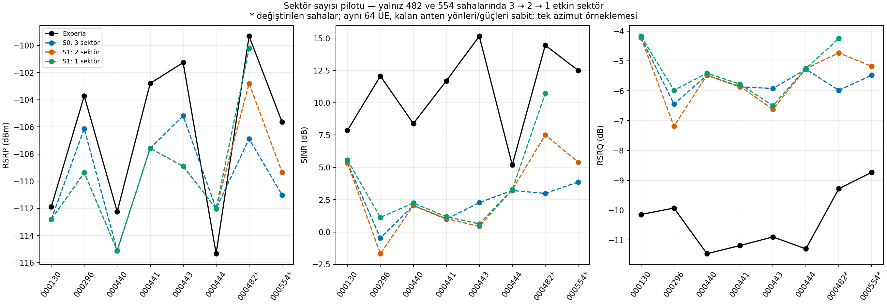
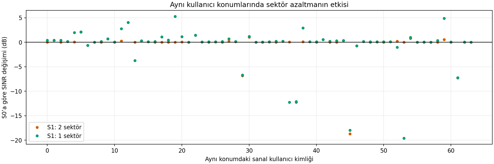

# İki sahada sektör sayısı deneyi

Hocanın kırmızı notu: “cell sayısına bakmadan 3 sektöre böldüm ama bakılması lazım.” Üç sektör, hocanın ilk örnekte kullandığı ve incelenmesini istediği başlangıç varsayımıdır.

İki hücre gözlenen ana sahalar **SITE_000482 ve SITE_000554** üzerinde üç, iki ve bir etkin sektör denendi. Diğer 22 saha üç sektörlü kaldı. 24 saha, aynı 64 kullanıcı, aynı yayılım modeli, seed, frekans, 4 saniyelik süre ve düşük UDP probu kullanıldı.

Özgün üç sektörlü sonuç yeni kodla yeniden üretildi; alternatifler başlamadan önce 64 kullanıcının karşılaştırılan sonuçları doğrulandı (en büyük fark: 0). Ana projenin C++ kaynağı ve sabit başlangıç senaryosu değiştirilmedi.

## Sonuç tablosu

| Durum | Toplam sektör | Bağlanan / DL alan UE | RSRP üreten ana saha | Ana saha RSRP MAE | Ana saha SINR MAE | Kontrol SINR MAE |
|---|---:|---:|---:|---:|---:|---:|
| S0: 3 sektör | 72 | 64/64 — 60/64 | 8/8 | 3.90 dB | 8.38 dB | 9.97 dB |
| S1: 2 sektör | 70 | 64/64 — 57/64 | 8/8 | 4.04 dB | 7.99 dB | 10.57 dB |
| S1: 1 sektör | 68 | 64/64 — 57/64 | 7/8 | 3.73 dB | 7.15 dB | 10.39 dB |

**Bu pilot sektör azaltmayı bir iyileştirme olarak benimsemek için destek vermedi.** İki alternatifte de aynı 64 kullanıcının ortalama SINR değişimi negatiftir; ayrılmış kontrol sahalarının SINR hatası başlangıca göre büyümüştür. Bir sektörlü koşuda 554 sahası hiç kullanıcıya hizmet vermediği için saha hata ortalaması yalnız yedi sahaya dayanır. Bu düşük ortalama sekiz sahalık başlangıçla başarı sıralaması yapmak için kullanılamaz.

Eksik saha sayısı ve metrik ayrıntıları `summary.csv` içindedir. Ortalamalar geçerli sonucu olan sahaları kullanır; örneklem kaybı varsa ayrıca değerlendirilmelidir.

## Aynı kullanıcıları karşılaştırınca

- **S1: 2 sektör**: 64/64 kullanıcıda eşlenik SINR; ortalama değişim -0.50 dB, %95 mutlak değişim 6.43 dB; aynı hizmet saha/sektörü oranı %85.9.
  Başlangıçta değiştirilen iki sahadan hizmet alan aynı 15 kullanıcıda ortalama SINR değişimi -2.64 dB oldu.
- **S1: 1 sektör**: 64/64 kullanıcıda eşlenik SINR; ortalama değişim -0.69 dB, %95 mutlak değişim 11.37 dB; aynı hizmet saha/sektörü oranı %79.7.
  Başlangıçta değiştirilen iki sahadan hizmet alan aynı 15 kullanıcıda ortalama SINR değişimi -4.98 dB oldu.

## Nasıl yorumlanmalı?

- Bu bir duyarlılık pilotudur. Ölçümlerdeki iki hücrenin gerçekte bir veya iki sektör olduğunu kanıtlamaz.
- Tek sektör durumu tek bir 65° yönlü antendir; her yöne hizmet veren antene dönüştürülmedi. Kalan yönler ilk sektörlerdir: 0; veya 0 ve 1. Diğer yön seçimi/azimutlar denenmedi.
- Kalan antenlerin gücü değişmedi; sektör kaldırılınca toplam saha gücü ve bazı yönlerde kapsama azalır. Bu nedenle girişim azalması ve istenen sinyal kaybı birlikte gerçekleşebilir.
- Kullanıcı başka sahaya geçerse saha ortalamasına giren kullanıcılar değişir. Bu yüzden saha hataları yanında aynı 64 konumdaki eşlenik farklar da verildi.
- Bütün durumlar tek taşıyıcılı ve aynı frekansta. Gerçek çok taşıyıcılı S2 hipotezi uygulanmadı.
- Sekiz saha daha önce görüldü; bu yeni bir kör doğrulama veya yeni başlangıç senaryosu seçimi değildir.
- SITE_000554 konumunun ana envanterdeki kaynak belirsizliği devam ediyor. Bu koşullarda komşu saha yakınsaması yeniden sınanmadı; sonuçlar mevcut 24 saha içindir.
- Bu kısa UDP probu bir yük veya kapasite deneyi değildir.

## Görseller

## Tekrar üretim

Proje kökünde Windows Python ile `experiments/sector_sensitivity_2026-11-10/prepare.py`; ardından Ubuntu-22.04 Python ile `run_experiment.py`; son olarak Windows proje Python ile `report.py` çalıştırılır. Girdiler ve C++ kaynak hash’leri `experiment_plan.json` içinde, ham çıktılar `simulation/results/` altındadır.
